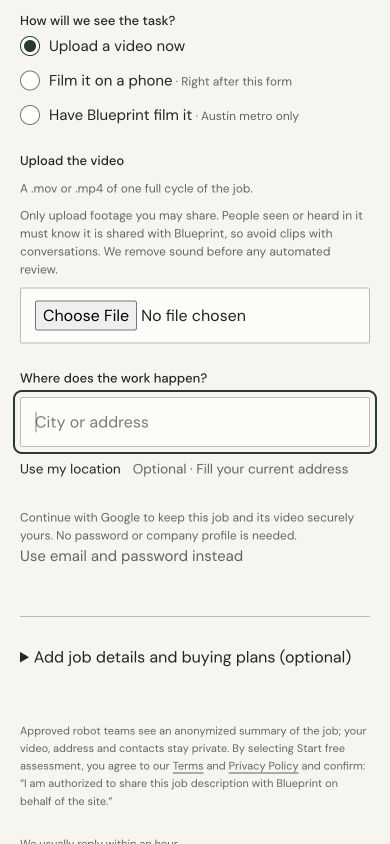

# Customer journey simplification

Owner direction, 2026-10-28: implement the cross-repo audit's cuts and simplify the customer experience. This slice unblocks the beta's upload, drafted brief, preparation and result review steps. The intended customer journey remains video → correct the drafted brief → assessment and proposals → select and agree a pilot.

## Implemented in this slice

- Upload no longer waits for the browser to decode a video or measure FPS. The server probes the retained original MOV/MP4 with the pinned ffprobe package. Measured metadata identifies its source and timestamp basis; unavailable measurements never become invented defaults.
- The existing private upload receipt retains the original bytes before measurement. An unreadable file remains saved with a repair message and no processing marker. A probe deployment failure can retry the same stored generation without reuploading, changing its owner/permission snapshot or starting a new paid run. The server releases its write claim before acknowledging a retryable result.
- Upload intake defaults to Google ownership. Password signup remains an explicit alternative; company is optional. A detached, in-memory Firebase instance preserves the form and selected video while establishing the owner before the source arrives. Phone and visit drafts retain their existing account/ownership rules.
- Preparation requires grounded job evidence and grounded reasons for a plausible approach. An unrelated quarantined advisory claim no longer vetoes preparation. The independent source, privacy, permission and execution checks still apply.
- Job summaries, limitations and the primary next action stay visible. Detailed claim IDs, hashes, candidate tables and duplicate per-result actions move into supporting-evidence disclosures.

## Verification and boundaries

Focused tests exercise the real upload routes with playable synthetic media and the installed ffprobe binary; storage, authentication exchanges and external providers are substituted. They cover immutable source recovery, ownership, permission withdrawal, app/browser source conflicts, manifested measurements and no publication for unreadable bytes. Component tests cover the account alternatives, durable drafts and result disclosures. The account initialization test uses Firebase's actual browser SDK and substitutes credential exchanges only, protecting the detached popup resolver and memory-only persistence.

`npm run check` passes. The required Graphify AST refresh passes. A local Vite browser check using synthetic Firebase configuration showed no horizontal overflow at 390 px, no password/company requirement for Google upload intake, and working switches between the account alternatives. It made no account, upload, provider or production mutation.

Pipeline's existing preserved-scene and optional-support-output paths passed 50 focused tests (`test_atlas_preserved_scene.py`, `test_atlas_scene_preservation.py`, `test_qualification_support_outputs.py`). Those paths already avoid unnecessary object removal/inpainting and support reports; they do not require another implementation.

This slice does not implement same-job supplemental/replacement source admission or the screening-to-full-scoring continuation. Both remain part of the active owner goal. Supplemental footage currently lacks an end-to-end immutable source/owner join; full scoring still needs the existing explicit owner spending authority. No changed UI or diagnostic screening result grants either authority. Nothing here has been deployed or verified by a fresh production upload.
