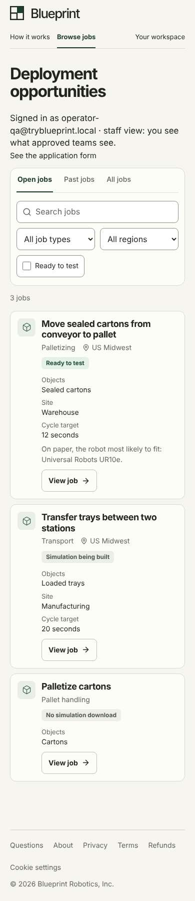
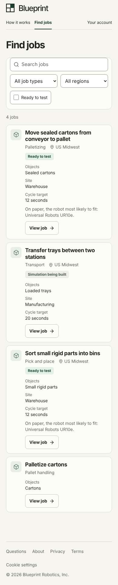
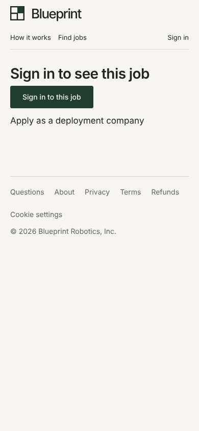
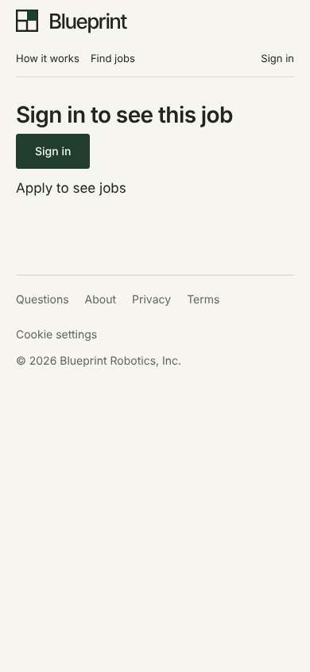
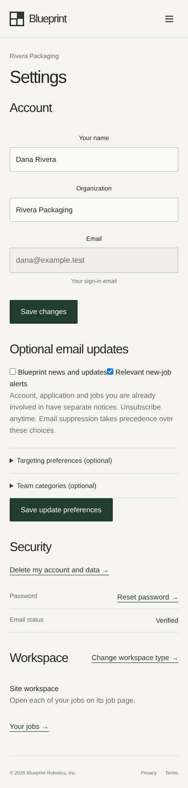
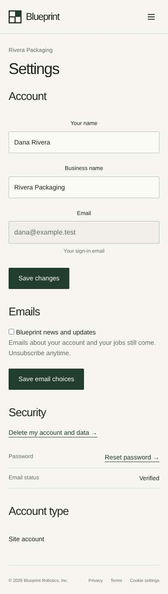
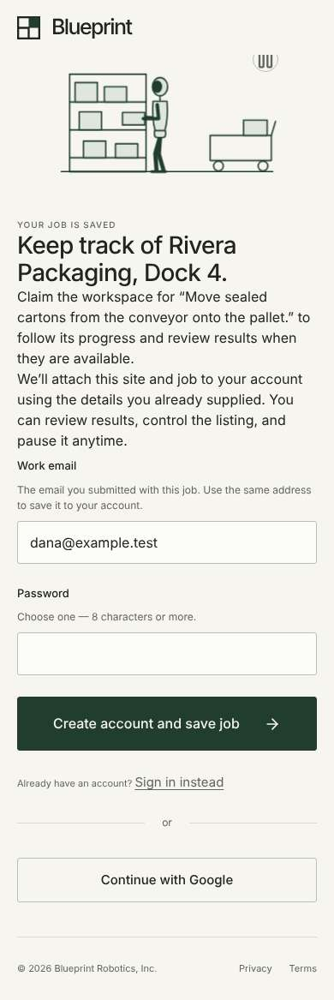
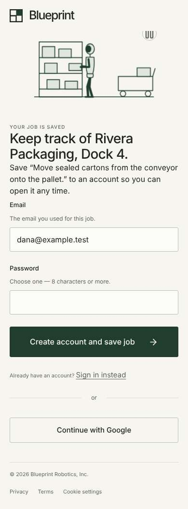

# Launch copy: Company flow, accounts, workspace and Settings, every change

The full record behind this part of the launch-copy work: every changed customer-visible string, the screenshots and the test results. Glossary and decisions: [decisions.md](decisions.md).

Part 3 of the launch-copy work. Everything a deployment company sees, plus accounts, the workspace and Settings.

**What changes:**
- The job list no longer shows "Signed in as {email} · staff view…". Staff now see exactly what an approved company sees.
- One name for the job list: **Find jobs**.
- A company that has already applied is no longer asked to apply again.
- The answer form and its labels are explained in plain words.
- Settings drops the engineering targeting block (embodiments, policy categories, data retention, rights scopes). Sites don't see the job-email box.
- `/onboarding` used to show a checklist written in pipeline terms. It now forwards a site to its jobs and an approved company to Find jobs.
- Sign-in, sign-up, forgot password, claim and the deletion receipt are in plain words. The receipt still says nothing is deleted yet.

The simulation README companies download is in the Pipeline PR, linked below once it is open.

## Before / after
Every changed customer-visible string (74). The audit row behind each one, with the test it touched, is in `docs/qa/launch-copy-audit/findings.md` (PR [ognjhunt/Blueprint-WebApp#1365](https://github.com/ognjhunt/Blueprint-WebApp/pull/1365)).

| surface | before | after |
|---|---|---|
| Find jobs label (signed-in header, AppShell nav, Overview action, job … | Browse jobs | Find jobs |
| Job list h1 and SEO title (/contact/robot-team, approved) | Deployment opportunities | Find jobs |
| Job list, staff viewing | Signed in as {email} · staff view: you see what approved teams see. See the application form | (removed) |
| Job list view toggle | Open jobs / Past jobs / All jobs (+ 'No past jobs.', 'See all jobs') | (removed) |
| Job list empty state | The first site jobs are being prepared. / Jobs appear here when the video and job details are ready to review. | No jobs yet. / New jobs appear here when their video is ready. |
| Job list filtered empty | No jobs match these filters. \| No past jobs. \| No open jobs right now. | No jobs match these filters. |
| Job card simulation label | No simulation download | (no label) |
| Job card simulation label | Video received | Simulation not started yet |
| Apply section (job list / job page, not approved) | Approved deployment companies can browse jobs and respond. [Apply → /partners#partner-application] (region 'Early access') | Approved deployment companies can see jobs and respond. [Apply → /jobs#partner-application] (region 'Apply to see jobs') |
| Application pending | We'll email {email} if your company is approved. | We'll email you if your company is approved. |
| Application form heading | Apply for access | Apply to see jobs |
| Application form intro | We review each application by hand. Once approved, you get an email for each new job. Nothing is charged today. | We approve each company before it sees jobs. Once approved, you get an email for each new job. Nothing is charged today. |
| Application website disclosure | Add a website (optional) | Add your website |
| Application error (server) | Check the application: name, work email, company, what your robot does and the work you want to test it on are required. | Check the form. Every field is needed except the website, which must start with https:// or http://. |
| Application refused, stale Terms (server, /apply only) | Agree to the current Terms and Privacy Policy. | Our Terms or Privacy Policy changed. Reload the page and apply again. |
| Lost invitation form error (server) | Enter the email address your team was approved with. | Enter the email address your company was approved with. |
| Company sign-up without invitation (SEO title / description / intro / … | Request access \| Blueprint / Robot-team accounts are available by invitation after review and approval. / Register your robot team. We’ll invite you after the required review and approval. / Apply fo… | Access by invitation \| Blueprint / Accounts for deployment companies Blueprint has approved. / Deployment companies apply first. Once we approve your company, we email you a link to create your accou… |
| Company sign-up while checking | We’re checking the approval for this email address. | (removed) |
| Company sign-up invitation valid | Your robot team is approved. Use the email address on your invitation. | Your company is approved. Use the email address on your invitation. |
| Company sign-up validation | Enter your name and organization, and accept the Terms and Privacy Policy. | Enter your name and company, and agree to the Terms and Privacy Policy. |
| Company job page, quick-answers hint | The site's own answers on its job page; not checked. | The site's own answers. Blueprint has not checked them. |
| Company job page, signed out | Sign in to this job / Apply as a deployment company | Sign in / Apply to see jobs |
| Company job page, refused (approved company) | This job is not available / It may no longer be shared, or your account may not be approved. Back to jobs | This job is no longer available / Back to jobs |
| Company job page, refused (never applied) | This job is not available / It may no longer be shared, or your account may not be approved. Back to jobs | This job is not available / Only approved deployment companies can see jobs. Apply to see jobs |
| Company job page, top action | Respond to opportunity | Respond |
| Company job page, missing sentence | The site has not described the job in its own words. | The site's description can't be shown right now. |
| Company job page, Simulation of the site | The site's scene for this job. The README inside says what it holds. Test in your own tools. / Open scene.usda. The room's look is a Gaussian splat that some tools cannot show; the collision mesh is i… | A 3D simulation of the site, to test in your own tools. Open scene.usda first; the README inside explains each file. |
| Company answer form | Response to opportunity (form name) / Is this a fit for your team? / Note to the site (optional) / Add details (optional) / What you’ve verified / You answered {label} on {date}. / Your answer was not… | Your response / Is this job a fit for your company? / Note to the site / Add details / What you have checked / You answered “{label}” on {date}. / We could not reach Blueprint. Check your connection a… |
| Company answer saved / refused (server) | Saved. The site is told this answer under an alias. Answering commits nobody. / Job unavailable / This job is not open to answers. | Saved. The site sees this answer, without your company's name. / Your response could not be saved just now. Try again. / This job is no longer shared, so it can't take responses. |
| Company job page, What this job packet does not show | The way in: the route from the site's entrance to the job, its doorways, aisle widths, steps, ramps and floor surface were not measured. A simulation holds only what the video filmed. / The site's saf… | The way in: doorways, aisles, steps, ramps and floors between the entrance and the job were not measured. The simulation holds only what the video filmed. / The site's safety rules, such as guarding, … |
| Site job page, response without reason | No reason we can show. | No reason shared. |
| Save job to account, intro | Claim the workspace for “{task}” to follow its progress and review results when they are available. (fallback: Create an account or sign in to follow job progress and review results when they are avai… | Save “{task}” to an account so you can open it any time. (fallback: Create an account or sign in so you can open this job any time.) / (second paragraph removed) |
| Save job to account, form | Claim this site (form name) / Work email / The email you submitted with this job. Use the same address to save it to your account. / Create one | Save this job to your account / Email / The email you used for this job. / Create an account |
| Save job to account, invalid link | That link has expired. / {message} Request a fresh one from your workspace, or email hello@tryblueprint.io. (also shown for a 503) | This link doesn't work. / {message} For a new one, open your job page and choose Job settings › Save to my account, or write to hello@tryblueprint.io. (a 5xx gets the retry screen) |
| Save job to account, load error | We could not check this claim link. Check your connection and try again. | Check your connection and try again. |
| Save job to account, verify / saved / already saved / failure | We sent a verification link to {email}. Return here after verifying to attach this site to your workspace. / This site is yours. {site} is now in your account. Your jobs open from your account. On you… | We sent a link to {email}. Open it to finish saving this job to your account. / Saved to your account. {site} is now in your account. Open it from Your jobs any time. You can still withdraw your job o… |
| Account error, email in use | An account already uses this email. Choose “I already have an account” and sign in. | An account already uses this email. Sign in instead. |
| Save-to-account refusals (server) | Verify your email before claiming a site. / That claim link is not valid any more. / Sign in with the submission email to claim this site. / Accept the Terms and Privacy Policy to claim this site. / S… | Verify your email first, then try again. / This link has expired. Press Save to my account on your job page for a new one. / Sign in with the email you used for this job. / Accept the Terms and Privac… |
| Account pages, server errors | Workspace storage is unavailable. Please try again. / The workspace could not be updated. Please try again. / Complete intake and wait for Blueprint to approve your account invitation. / Accept the Te… | We could not load your account. Please try again. / Your account could not be updated. Please try again. / Apply first. Once we approve your company, we email you a link to set up your account. / Acce… |
| Sign in, field validation | Email is required / Please enter a valid email address / Password is required | Enter your email. / Enter a valid email address. / Enter your password. |
| Sign in, failure | Invalid email or password. (every failure) | That email and password do not match an account. (credential codes); account and network errors in words; otherwise 'We could not sign you in. Please try again.' |
| Sign in, SEO description | Sign in to your Blueprint account to follow your site jobs and their results. | Sign in to your Blueprint account. |
| Sign in, blocked Google window box | Tap the browser menu and choose Open in Safari. If that option is unavailable, copy this link and paste it into Safari. You’ll return to the job page after sign-in. \| Your result will open after sign… | Copy this link and open it in Safari or Chrome, then sign in there. / Copy link / Link to open in Safari or Chrome |
| Sign in, bottom links | New to Blueprint? Start a job | (company return path) New deployment company? Apply to see jobs; (otherwise) New to Blueprint? Start a job + Lost your job link? Email hello@tryblueprint.io from the address you used. |
| Sign in / Google, mapped errors | Access to Blueprint is currently invite-only. Please request an invitation to continue. / Blueprint access is currently invite-only. Please request an invitation to continue. / Invalid email address /… | We couldn't open your account. Please try again, or write to hello@tryblueprint.io. (both) / That email address does not look right. / Google sign-in isn't available here. Use your email and password.… |
| /onboarding (Finish setup checklist) | Finish setup / Your account is ready. Review your details, then open your workspace. / Account details… / Intake summary & next steps (proof path, buyer type, review queue, scoping call…) / Site acces… | Loading… (forwards at once: site → /app, approved company → Find jobs, others → /app) |
| Your jobs (/app) header action and empty states | Show us a job / Start with one job: Send us a video of the job you want a robot to do. Jobs saved to your account open from here. [Show us a job] / Deployment opportunities: Review jobs shared by site… | Start a job / (unverified site) Verify your email to see your jobs: Open the verification link we email you, then sign in again. [Send verification email] / (verified site) No jobs yet: same body [Sta… |
| Settings, account form label | Organization | Company (deployment company) / Business name (site) |
| Settings, Workspace section | Workspace [Change workspace type →] / Robot-team workspace \| Site workspace / Read the job summaries shared with you and answer them. \| Open each of your jobs on its job page. / Open overview → \| Y… | Account type / Deployment company account \| Site account |
| Settings, email preferences | Optional email updates / [Blueprint news and updates] [Relevant new-job alerts] / Account, application and jobs you are already involved in have separate notices. Unsubscribe anytime. Email suppressio… | Emails / [Blueprint news and updates] [Relevant new-job alerts — deployment companies only] / Emails about your account and your jobs still come. Unsubscribe anytime. / Save email choices |
| Account setup (no type yet) | Set up your workspace \| Workspace setup / Choose how you’ll use Blueprint, then add your site or robot details. / Organization / Workspace type / Choose a workspace / Robot team — I want to test my r… | Set up your account \| Account type / Are you a site or a deployment company? / Business name \| Company / Account type / Choose one / Deployment company — I deploy robots / Start a job and follow it … |
| Account setup, site path | Show us the work. We’ll use your submitted details to set up the workspace and save the job to your account. / Show us a task → / Choose another workspace | Start a job first. We set up your account from it. / Start a job → / Back |
| Account pages loading and fallback name | Loading your workspace… / Your workspace | Loading… / Your account |
| Account sidebar label, nav name, fallback and footer | Workspace setup \| Site workspace \| Robot-team workspace / Your workspace / Privacy · Terms | Account setup \| Site account \| Deployment company account / Your account / Privacy · Terms · Cookie settings |
| Settings ?setup=1 breadcrumb | Workspace setup | Account setup |
| Delete my account and data | Request closure of your Blueprint account and deletion of your personal data. We review linked jobs, shared recordings, provider copies and any legal retention requirements before processing the reque… | Ask us to close your account and delete your personal data. First we check your jobs and the videos you shared. We also check copies our service providers hold, and what the law says we must keep. / N… |
| Account pages render error | Something went wrong. Please try again. | Something went wrong. Reload the page to try again. If it keeps happening, email hello@tryblueprint.io. |
| Account pages, auth errors (server) | Missing or invalid authorization / Firebase Admin auth is not configured on this server. / Invalid or expired token | Please sign in again. / Sign-in isn't working on our side right now. Please try again shortly. / Your sign-in has expired. |
| Start form, invite list refusals (server, only when the allowlist is s… | Blueprint's beta is invite-only for now, and this email is not on the list. / Please verify your email address first; Blueprint's beta is invite-only and checks the verified address. / Blueprint canno… | Blueprint is taking jobs from invited sites only for now, and this email is not on the list. / Verify your email address first, then try again. / We can't take new jobs right now. Please try again lat… |
| Simulation README, title and What this is | Simulation of one job / A simulation of the site a deployment company was asked about, … | Simulation of the site / A simulation of the site for this job, … |
| Simulation README, look file naming | how the site looks / the room's look / the room's photographed look / the appearance file | the look file (e.g. 'the look file, which shows how the site looks'; 'The look file is not in this package: …'; 'The look file did not pass Blueprint's image quality check; it is included as it is.') |
| Simulation README, first-written look | The room's look is in this package as Blueprint first wrote it, and only as USD: Blueprint could not write it again for this package. / That first writing stored each Gaussian's rotation in the wrong … | The look file is included as USD only, in an earlier version. / In that version each Gaussian's rotation is stored in the wrong order, so the look may not show correctly. |
| Simulation README, counts and units | {n} movable item(s) the site agreed to move are not in the collision file; they still appear in the appearance file. / {n} object(s) the job involves were taken out… / 1 metres per unit | 1 movable item … is not in the collision file; it still appears in the look file. / {n} movable items … are … they still appear in the look file. / 1 object the job involves was taken out of the room … |
| Simulation README, not prepared / hidden part | Blueprint could not prepare the job's {piece} ({codes}). / /World/{prim} is in the scene but hidden, as in Blueprint's simulation, where it is used for contact and not drawn. To see it, … | Blueprint could not prepare the job's {piece}. / /World/{prim} is hidden: it is for contact, not for display. To see it, … |
| Simulation README, notes layout and Terms | (all notes run together in one paragraph after 'How it was made') / This package is for judging this one job. Do not pass it on … | Notes on this simulation (one '- ' bullet per note) / Use this package only to decide whether you can do this job. Do not pass it on … (rest unchanged) |
| Company job page packet facts | not recorded (invalid value) / Which way is up was not observed; the reconstruction provider's up direction stands in. / The scene review cited frames that could not be used; those citations were left… | not known / Which way is up was not seen in the video; it was estimated. / (left out) / Some views of the surroundings were left out. / Some parts of the job were only partly filmed, such as where the… |
| Workspace tag | Recording permission withdrawn | Video withdrawn |
| Account load error | Could not load your workspace. Please try again. | We could not load your account. Please try again. |
| Claim link error | This claim link is not valid or has expired. | This link has expired or is not valid. |
| Account deletion receipt | Your request is recorded for privacy review. Your account remains active until we process it. We will confirm the outcome, including any records that must be retained. This receipt does not confirm de… | We have your request. Nothing is deleted yet, and your account stays open until we finish. We'll tell you what we deleted and anything we must keep. |
| Job list heading, company that already applied | Apply to see jobs | Find jobs |
| Sign-in pages illustration caption | Illustrative scene | Illustration |
| Sign-in pages footer | Privacy · Terms | Privacy · Terms · Cookie settings |
| Company application links | /partners?next=…#partner-application | /jobs?next=…#partner-application |

## Screenshots
Before: the audit inventory. After: the same harness, run on all four launch-copy branches merged. Desktop is 1280 px wide, phone 390 px.

**job-library** (staff), before → after (phone)

 

**company-job** (signed-out), before → after (phone)

 

**settings** (site-signed-in), before → after (phone)

 

**claim** (site-token), before → after (phone)

 

| screen | persona | before | after |
|---|---|---|---|
| claim | site-token | [desktop](https://github.com/ognjhunt/Blueprint-WebApp/blob/a0365cb52478434fa1d0d925761851c07887c8ea/docs/qa/launch-copy-audit/screens/claim__site-token__1280.jpg) · [phone](https://github.com/ognjhunt/Blueprint-WebApp/blob/a0365cb52478434fa1d0d925761851c07887c8ea/docs/qa/launch-copy-audit/screens/claim__site-token__390.jpg) | [desktop](https://github.com/ognjhunt/Blueprint-WebApp/blob/a0365cb52478434fa1d0d925761851c07887c8ea/docs/qa/launch-copy-audit/after/claim__site-token__1280.jpg) · [phone](https://github.com/ognjhunt/Blueprint-WebApp/blob/a0365cb52478434fa1d0d925761851c07887c8ea/docs/qa/launch-copy-audit/after/claim__site-token__390.jpg) |
| claim-invalid | site-token | [desktop](https://github.com/ognjhunt/Blueprint-WebApp/blob/a0365cb52478434fa1d0d925761851c07887c8ea/docs/qa/launch-copy-audit/screens/claim-invalid__site-token__1280.jpg) · [phone](https://github.com/ognjhunt/Blueprint-WebApp/blob/a0365cb52478434fa1d0d925761851c07887c8ea/docs/qa/launch-copy-audit/screens/claim-invalid__site-token__390.jpg) | [desktop](https://github.com/ognjhunt/Blueprint-WebApp/blob/a0365cb52478434fa1d0d925761851c07887c8ea/docs/qa/launch-copy-audit/after/claim-invalid__site-token__1280.jpg) · [phone](https://github.com/ognjhunt/Blueprint-WebApp/blob/a0365cb52478434fa1d0d925761851c07887c8ea/docs/qa/launch-copy-audit/after/claim-invalid__site-token__390.jpg) |
| company-job | company-applied | [desktop](https://github.com/ognjhunt/Blueprint-WebApp/blob/a0365cb52478434fa1d0d925761851c07887c8ea/docs/qa/launch-copy-audit/screens/company-job__company-applied__1280.jpg) · [phone](https://github.com/ognjhunt/Blueprint-WebApp/blob/a0365cb52478434fa1d0d925761851c07887c8ea/docs/qa/launch-copy-audit/screens/company-job__company-applied__390.jpg) | [desktop](https://github.com/ognjhunt/Blueprint-WebApp/blob/a0365cb52478434fa1d0d925761851c07887c8ea/docs/qa/launch-copy-audit/after/company-job__company-applied__1280.jpg) · [phone](https://github.com/ognjhunt/Blueprint-WebApp/blob/a0365cb52478434fa1d0d925761851c07887c8ea/docs/qa/launch-copy-audit/after/company-job__company-applied__390.jpg) |
| company-job | company-approved | [desktop](https://github.com/ognjhunt/Blueprint-WebApp/blob/a0365cb52478434fa1d0d925761851c07887c8ea/docs/qa/launch-copy-audit/screens/company-job__company-approved__1280.jpg) · [phone](https://github.com/ognjhunt/Blueprint-WebApp/blob/a0365cb52478434fa1d0d925761851c07887c8ea/docs/qa/launch-copy-audit/screens/company-job__company-approved__390.jpg) | [desktop](https://github.com/ognjhunt/Blueprint-WebApp/blob/a0365cb52478434fa1d0d925761851c07887c8ea/docs/qa/launch-copy-audit/after/company-job__company-approved__1280.jpg) · [phone](https://github.com/ognjhunt/Blueprint-WebApp/blob/a0365cb52478434fa1d0d925761851c07887c8ea/docs/qa/launch-copy-audit/after/company-job__company-approved__390.jpg) |
| company-job | company-terms-gate | [desktop](https://github.com/ognjhunt/Blueprint-WebApp/blob/a0365cb52478434fa1d0d925761851c07887c8ea/docs/qa/launch-copy-audit/screens/company-job__company-terms-gate__1280.jpg) · [phone](https://github.com/ognjhunt/Blueprint-WebApp/blob/a0365cb52478434fa1d0d925761851c07887c8ea/docs/qa/launch-copy-audit/screens/company-job__company-terms-gate__390.jpg) | [desktop](https://github.com/ognjhunt/Blueprint-WebApp/blob/a0365cb52478434fa1d0d925761851c07887c8ea/docs/qa/launch-copy-audit/after/company-job__company-terms-gate__1280.jpg) · [phone](https://github.com/ognjhunt/Blueprint-WebApp/blob/a0365cb52478434fa1d0d925761851c07887c8ea/docs/qa/launch-copy-audit/after/company-job__company-terms-gate__390.jpg) |
| company-job | signed-out | [desktop](https://github.com/ognjhunt/Blueprint-WebApp/blob/a0365cb52478434fa1d0d925761851c07887c8ea/docs/qa/launch-copy-audit/screens/company-job__signed-out__1280.jpg) · [phone](https://github.com/ognjhunt/Blueprint-WebApp/blob/a0365cb52478434fa1d0d925761851c07887c8ea/docs/qa/launch-copy-audit/screens/company-job__signed-out__390.jpg) | [desktop](https://github.com/ognjhunt/Blueprint-WebApp/blob/a0365cb52478434fa1d0d925761851c07887c8ea/docs/qa/launch-copy-audit/after/company-job__signed-out__1280.jpg) · [phone](https://github.com/ognjhunt/Blueprint-WebApp/blob/a0365cb52478434fa1d0d925761851c07887c8ea/docs/qa/launch-copy-audit/after/company-job__signed-out__390.jpg) |
| company-job-answer-sent | company-approved | [desktop](https://github.com/ognjhunt/Blueprint-WebApp/blob/a0365cb52478434fa1d0d925761851c07887c8ea/docs/qa/launch-copy-audit/screens/company-job-answer-sent__company-approved__1280.jpg) · [phone](https://github.com/ognjhunt/Blueprint-WebApp/blob/a0365cb52478434fa1d0d925761851c07887c8ea/docs/qa/launch-copy-audit/screens/company-job-answer-sent__company-approved__390.jpg) | [desktop](https://github.com/ognjhunt/Blueprint-WebApp/blob/a0365cb52478434fa1d0d925761851c07887c8ea/docs/qa/launch-copy-audit/after/company-job-answer-sent__company-approved__1280.jpg) · [phone](https://github.com/ognjhunt/Blueprint-WebApp/blob/a0365cb52478434fa1d0d925761851c07887c8ea/docs/qa/launch-copy-audit/after/company-job-answer-sent__company-approved__390.jpg) |
| company-job-sim-ready | company-approved | [desktop](https://github.com/ognjhunt/Blueprint-WebApp/blob/a0365cb52478434fa1d0d925761851c07887c8ea/docs/qa/launch-copy-audit/screens/company-job-sim-ready__company-approved__1280.jpg) · [phone](https://github.com/ognjhunt/Blueprint-WebApp/blob/a0365cb52478434fa1d0d925761851c07887c8ea/docs/qa/launch-copy-audit/screens/company-job-sim-ready__company-approved__390.jpg) | [desktop](https://github.com/ognjhunt/Blueprint-WebApp/blob/a0365cb52478434fa1d0d925761851c07887c8ea/docs/qa/launch-copy-audit/after/company-job-sim-ready__company-approved__1280.jpg) · [phone](https://github.com/ognjhunt/Blueprint-WebApp/blob/a0365cb52478434fa1d0d925761851c07887c8ea/docs/qa/launch-copy-audit/after/company-job-sim-ready__company-approved__390.jpg) |
| company-job-sim-ready | staff | [desktop](https://github.com/ognjhunt/Blueprint-WebApp/blob/a0365cb52478434fa1d0d925761851c07887c8ea/docs/qa/launch-copy-audit/screens/company-job-sim-ready__staff__1280.jpg) · [phone](https://github.com/ognjhunt/Blueprint-WebApp/blob/a0365cb52478434fa1d0d925761851c07887c8ea/docs/qa/launch-copy-audit/screens/company-job-sim-ready__staff__390.jpg) | [desktop](https://github.com/ognjhunt/Blueprint-WebApp/blob/a0365cb52478434fa1d0d925761851c07887c8ea/docs/qa/launch-copy-audit/after/company-job-sim-ready__staff__1280.jpg) · [phone](https://github.com/ognjhunt/Blueprint-WebApp/blob/a0365cb52478434fa1d0d925761851c07887c8ea/docs/qa/launch-copy-audit/after/company-job-sim-ready__staff__390.jpg) |
| company-job-tested-form | company-approved | [desktop](https://github.com/ognjhunt/Blueprint-WebApp/blob/a0365cb52478434fa1d0d925761851c07887c8ea/docs/qa/launch-copy-audit/screens/company-job-tested-form__company-approved__1280.jpg) · [phone](https://github.com/ognjhunt/Blueprint-WebApp/blob/a0365cb52478434fa1d0d925761851c07887c8ea/docs/qa/launch-copy-audit/screens/company-job-tested-form__company-approved__390.jpg) | [desktop](https://github.com/ognjhunt/Blueprint-WebApp/blob/a0365cb52478434fa1d0d925761851c07887c8ea/docs/qa/launch-copy-audit/after/company-job-tested-form__company-approved__1280.jpg) · [phone](https://github.com/ognjhunt/Blueprint-WebApp/blob/a0365cb52478434fa1d0d925761851c07887c8ea/docs/qa/launch-copy-audit/after/company-job-tested-form__company-approved__390.jpg) |
| company-job-unavailable | company-approved | [desktop](https://github.com/ognjhunt/Blueprint-WebApp/blob/a0365cb52478434fa1d0d925761851c07887c8ea/docs/qa/launch-copy-audit/screens/company-job-unavailable__company-approved__1280.jpg) · [phone](https://github.com/ognjhunt/Blueprint-WebApp/blob/a0365cb52478434fa1d0d925761851c07887c8ea/docs/qa/launch-copy-audit/screens/company-job-unavailable__company-approved__390.jpg) | [desktop](https://github.com/ognjhunt/Blueprint-WebApp/blob/a0365cb52478434fa1d0d925761851c07887c8ea/docs/qa/launch-copy-audit/after/company-job-unavailable__company-approved__1280.jpg) · [phone](https://github.com/ognjhunt/Blueprint-WebApp/blob/a0365cb52478434fa1d0d925761851c07887c8ea/docs/qa/launch-copy-audit/after/company-job-unavailable__company-approved__390.jpg) |
| forgot-password | signed-out | [desktop](https://github.com/ognjhunt/Blueprint-WebApp/blob/a0365cb52478434fa1d0d925761851c07887c8ea/docs/qa/launch-copy-audit/screens/forgot-password__signed-out__1280.jpg) · [phone](https://github.com/ognjhunt/Blueprint-WebApp/blob/a0365cb52478434fa1d0d925761851c07887c8ea/docs/qa/launch-copy-audit/screens/forgot-password__signed-out__390.jpg) | [desktop](https://github.com/ognjhunt/Blueprint-WebApp/blob/a0365cb52478434fa1d0d925761851c07887c8ea/docs/qa/launch-copy-audit/after/forgot-password__signed-out__1280.jpg) · [phone](https://github.com/ognjhunt/Blueprint-WebApp/blob/a0365cb52478434fa1d0d925761851c07887c8ea/docs/qa/launch-copy-audit/after/forgot-password__signed-out__390.jpg) |
| job-library | company-applied | [desktop](https://github.com/ognjhunt/Blueprint-WebApp/blob/a0365cb52478434fa1d0d925761851c07887c8ea/docs/qa/launch-copy-audit/screens/job-library__company-applied__1280.jpg) · [phone](https://github.com/ognjhunt/Blueprint-WebApp/blob/a0365cb52478434fa1d0d925761851c07887c8ea/docs/qa/launch-copy-audit/screens/job-library__company-applied__390.jpg) | [desktop](https://github.com/ognjhunt/Blueprint-WebApp/blob/a0365cb52478434fa1d0d925761851c07887c8ea/docs/qa/launch-copy-audit/after/job-library__company-applied__1280.jpg) · [phone](https://github.com/ognjhunt/Blueprint-WebApp/blob/a0365cb52478434fa1d0d925761851c07887c8ea/docs/qa/launch-copy-audit/after/job-library__company-applied__390.jpg) |
| job-library | company-approved | [desktop](https://github.com/ognjhunt/Blueprint-WebApp/blob/a0365cb52478434fa1d0d925761851c07887c8ea/docs/qa/launch-copy-audit/screens/job-library__company-approved__1280.jpg) · [phone](https://github.com/ognjhunt/Blueprint-WebApp/blob/a0365cb52478434fa1d0d925761851c07887c8ea/docs/qa/launch-copy-audit/screens/job-library__company-approved__390.jpg) | [desktop](https://github.com/ognjhunt/Blueprint-WebApp/blob/a0365cb52478434fa1d0d925761851c07887c8ea/docs/qa/launch-copy-audit/after/job-library__company-approved__1280.jpg) · [phone](https://github.com/ognjhunt/Blueprint-WebApp/blob/a0365cb52478434fa1d0d925761851c07887c8ea/docs/qa/launch-copy-audit/after/job-library__company-approved__390.jpg) |
| job-library | company-approved-unverified | [desktop](https://github.com/ognjhunt/Blueprint-WebApp/blob/a0365cb52478434fa1d0d925761851c07887c8ea/docs/qa/launch-copy-audit/screens/job-library__company-approved-unverified__1280.jpg) · [phone](https://github.com/ognjhunt/Blueprint-WebApp/blob/a0365cb52478434fa1d0d925761851c07887c8ea/docs/qa/launch-copy-audit/screens/job-library__company-approved-unverified__390.jpg) | [desktop](https://github.com/ognjhunt/Blueprint-WebApp/blob/a0365cb52478434fa1d0d925761851c07887c8ea/docs/qa/launch-copy-audit/after/job-library__company-approved-unverified__1280.jpg) · [phone](https://github.com/ognjhunt/Blueprint-WebApp/blob/a0365cb52478434fa1d0d925761851c07887c8ea/docs/qa/launch-copy-audit/after/job-library__company-approved-unverified__390.jpg) |
| job-library | company-declined | [desktop](https://github.com/ognjhunt/Blueprint-WebApp/blob/a0365cb52478434fa1d0d925761851c07887c8ea/docs/qa/launch-copy-audit/screens/job-library__company-declined__1280.jpg) · [phone](https://github.com/ognjhunt/Blueprint-WebApp/blob/a0365cb52478434fa1d0d925761851c07887c8ea/docs/qa/launch-copy-audit/screens/job-library__company-declined__390.jpg) | [desktop](https://github.com/ognjhunt/Blueprint-WebApp/blob/a0365cb52478434fa1d0d925761851c07887c8ea/docs/qa/launch-copy-audit/after/job-library__company-declined__1280.jpg) · [phone](https://github.com/ognjhunt/Blueprint-WebApp/blob/a0365cb52478434fa1d0d925761851c07887c8ea/docs/qa/launch-copy-audit/after/job-library__company-declined__390.jpg) |
| job-library | company-empty | [desktop](https://github.com/ognjhunt/Blueprint-WebApp/blob/a0365cb52478434fa1d0d925761851c07887c8ea/docs/qa/launch-copy-audit/screens/job-library__company-empty__1280.jpg) · [phone](https://github.com/ognjhunt/Blueprint-WebApp/blob/a0365cb52478434fa1d0d925761851c07887c8ea/docs/qa/launch-copy-audit/screens/job-library__company-empty__390.jpg) | [desktop](https://github.com/ognjhunt/Blueprint-WebApp/blob/a0365cb52478434fa1d0d925761851c07887c8ea/docs/qa/launch-copy-audit/after/job-library__company-empty__1280.jpg) · [phone](https://github.com/ognjhunt/Blueprint-WebApp/blob/a0365cb52478434fa1d0d925761851c07887c8ea/docs/qa/launch-copy-audit/after/job-library__company-empty__390.jpg) |
| job-library | company-error | [desktop](https://github.com/ognjhunt/Blueprint-WebApp/blob/a0365cb52478434fa1d0d925761851c07887c8ea/docs/qa/launch-copy-audit/screens/job-library__company-error__1280.jpg) · [phone](https://github.com/ognjhunt/Blueprint-WebApp/blob/a0365cb52478434fa1d0d925761851c07887c8ea/docs/qa/launch-copy-audit/screens/job-library__company-error__390.jpg) | [desktop](https://github.com/ognjhunt/Blueprint-WebApp/blob/a0365cb52478434fa1d0d925761851c07887c8ea/docs/qa/launch-copy-audit/after/job-library__company-error__1280.jpg) · [phone](https://github.com/ognjhunt/Blueprint-WebApp/blob/a0365cb52478434fa1d0d925761851c07887c8ea/docs/qa/launch-copy-audit/after/job-library__company-error__390.jpg) |
| job-library | company-terms-gate | [desktop](https://github.com/ognjhunt/Blueprint-WebApp/blob/a0365cb52478434fa1d0d925761851c07887c8ea/docs/qa/launch-copy-audit/screens/job-library__company-terms-gate__1280.jpg) · [phone](https://github.com/ognjhunt/Blueprint-WebApp/blob/a0365cb52478434fa1d0d925761851c07887c8ea/docs/qa/launch-copy-audit/screens/job-library__company-terms-gate__390.jpg) | [desktop](https://github.com/ognjhunt/Blueprint-WebApp/blob/a0365cb52478434fa1d0d925761851c07887c8ea/docs/qa/launch-copy-audit/after/job-library__company-terms-gate__1280.jpg) · [phone](https://github.com/ognjhunt/Blueprint-WebApp/blob/a0365cb52478434fa1d0d925761851c07887c8ea/docs/qa/launch-copy-audit/after/job-library__company-terms-gate__390.jpg) |
| job-library | signed-out | [desktop](https://github.com/ognjhunt/Blueprint-WebApp/blob/a0365cb52478434fa1d0d925761851c07887c8ea/docs/qa/launch-copy-audit/screens/job-library__signed-out__1280.jpg) · [phone](https://github.com/ognjhunt/Blueprint-WebApp/blob/a0365cb52478434fa1d0d925761851c07887c8ea/docs/qa/launch-copy-audit/screens/job-library__signed-out__390.jpg) | [desktop](https://github.com/ognjhunt/Blueprint-WebApp/blob/a0365cb52478434fa1d0d925761851c07887c8ea/docs/qa/launch-copy-audit/after/job-library__signed-out__1280.jpg) · [phone](https://github.com/ognjhunt/Blueprint-WebApp/blob/a0365cb52478434fa1d0d925761851c07887c8ea/docs/qa/launch-copy-audit/after/job-library__signed-out__390.jpg) |
| job-library | staff | [desktop](https://github.com/ognjhunt/Blueprint-WebApp/blob/a0365cb52478434fa1d0d925761851c07887c8ea/docs/qa/launch-copy-audit/screens/job-library__staff__1280.jpg) · [phone](https://github.com/ognjhunt/Blueprint-WebApp/blob/a0365cb52478434fa1d0d925761851c07887c8ea/docs/qa/launch-copy-audit/screens/job-library__staff__390.jpg) | [desktop](https://github.com/ognjhunt/Blueprint-WebApp/blob/a0365cb52478434fa1d0d925761851c07887c8ea/docs/qa/launch-copy-audit/after/job-library__staff__1280.jpg) · [phone](https://github.com/ognjhunt/Blueprint-WebApp/blob/a0365cb52478434fa1d0d925761851c07887c8ea/docs/qa/launch-copy-audit/after/job-library__staff__390.jpg) |
| job-library-no-match | company-approved | [desktop](https://github.com/ognjhunt/Blueprint-WebApp/blob/a0365cb52478434fa1d0d925761851c07887c8ea/docs/qa/launch-copy-audit/screens/job-library-no-match__company-approved__1280.jpg) · [phone](https://github.com/ognjhunt/Blueprint-WebApp/blob/a0365cb52478434fa1d0d925761851c07887c8ea/docs/qa/launch-copy-audit/screens/job-library-no-match__company-approved__390.jpg) | [desktop](https://github.com/ognjhunt/Blueprint-WebApp/blob/a0365cb52478434fa1d0d925761851c07887c8ea/docs/qa/launch-copy-audit/after/job-library-no-match__company-approved__1280.jpg) · [phone](https://github.com/ognjhunt/Blueprint-WebApp/blob/a0365cb52478434fa1d0d925761851c07887c8ea/docs/qa/launch-copy-audit/after/job-library-no-match__company-approved__390.jpg) |
| job-library-past | company-approved | [desktop](https://github.com/ognjhunt/Blueprint-WebApp/blob/a0365cb52478434fa1d0d925761851c07887c8ea/docs/qa/launch-copy-audit/screens/job-library-past__company-approved__1280.jpg) · [phone](https://github.com/ognjhunt/Blueprint-WebApp/blob/a0365cb52478434fa1d0d925761851c07887c8ea/docs/qa/launch-copy-audit/screens/job-library-past__company-approved__390.jpg) | [desktop](https://github.com/ognjhunt/Blueprint-WebApp/blob/a0365cb52478434fa1d0d925761851c07887c8ea/docs/qa/launch-copy-audit/after/job-library-past__company-approved__1280.jpg) · [phone](https://github.com/ognjhunt/Blueprint-WebApp/blob/a0365cb52478434fa1d0d925761851c07887c8ea/docs/qa/launch-copy-audit/after/job-library-past__company-approved__390.jpg) |
| onboarding | site-signed-in | [desktop](https://github.com/ognjhunt/Blueprint-WebApp/blob/a0365cb52478434fa1d0d925761851c07887c8ea/docs/qa/launch-copy-audit/screens/onboarding__site-signed-in__1280.jpg) · [phone](https://github.com/ognjhunt/Blueprint-WebApp/blob/a0365cb52478434fa1d0d925761851c07887c8ea/docs/qa/launch-copy-audit/screens/onboarding__site-signed-in__390.jpg) | [desktop](https://github.com/ognjhunt/Blueprint-WebApp/blob/a0365cb52478434fa1d0d925761851c07887c8ea/docs/qa/launch-copy-audit/after/onboarding__site-signed-in__1280.jpg) · [phone](https://github.com/ognjhunt/Blueprint-WebApp/blob/a0365cb52478434fa1d0d925761851c07887c8ea/docs/qa/launch-copy-audit/after/onboarding__site-signed-in__390.jpg) |
| settings | company-approved | [desktop](https://github.com/ognjhunt/Blueprint-WebApp/blob/a0365cb52478434fa1d0d925761851c07887c8ea/docs/qa/launch-copy-audit/screens/settings__company-approved__1280.jpg) · [phone](https://github.com/ognjhunt/Blueprint-WebApp/blob/a0365cb52478434fa1d0d925761851c07887c8ea/docs/qa/launch-copy-audit/screens/settings__company-approved__390.jpg) | [desktop](https://github.com/ognjhunt/Blueprint-WebApp/blob/a0365cb52478434fa1d0d925761851c07887c8ea/docs/qa/launch-copy-audit/after/settings__company-approved__1280.jpg) · [phone](https://github.com/ognjhunt/Blueprint-WebApp/blob/a0365cb52478434fa1d0d925761851c07887c8ea/docs/qa/launch-copy-audit/after/settings__company-approved__390.jpg) |
| settings | site-signed-in | [desktop](https://github.com/ognjhunt/Blueprint-WebApp/blob/a0365cb52478434fa1d0d925761851c07887c8ea/docs/qa/launch-copy-audit/screens/settings__site-signed-in__1280.jpg) · [phone](https://github.com/ognjhunt/Blueprint-WebApp/blob/a0365cb52478434fa1d0d925761851c07887c8ea/docs/qa/launch-copy-audit/screens/settings__site-signed-in__390.jpg) | [desktop](https://github.com/ognjhunt/Blueprint-WebApp/blob/a0365cb52478434fa1d0d925761851c07887c8ea/docs/qa/launch-copy-audit/after/settings__site-signed-in__1280.jpg) · [phone](https://github.com/ognjhunt/Blueprint-WebApp/blob/a0365cb52478434fa1d0d925761851c07887c8ea/docs/qa/launch-copy-audit/after/settings__site-signed-in__390.jpg) |
| settings-privacy | site-signed-in | [desktop](https://github.com/ognjhunt/Blueprint-WebApp/blob/a0365cb52478434fa1d0d925761851c07887c8ea/docs/qa/launch-copy-audit/screens/settings-privacy__site-signed-in__1280.jpg) · [phone](https://github.com/ognjhunt/Blueprint-WebApp/blob/a0365cb52478434fa1d0d925761851c07887c8ea/docs/qa/launch-copy-audit/screens/settings-privacy__site-signed-in__390.jpg) | [desktop](https://github.com/ognjhunt/Blueprint-WebApp/blob/a0365cb52478434fa1d0d925761851c07887c8ea/docs/qa/launch-copy-audit/after/settings-privacy__site-signed-in__1280.jpg) · [phone](https://github.com/ognjhunt/Blueprint-WebApp/blob/a0365cb52478434fa1d0d925761851c07887c8ea/docs/qa/launch-copy-audit/after/settings-privacy__site-signed-in__390.jpg) |
| settings-setup | site-signed-in | [desktop](https://github.com/ognjhunt/Blueprint-WebApp/blob/a0365cb52478434fa1d0d925761851c07887c8ea/docs/qa/launch-copy-audit/screens/settings-setup__site-signed-in__1280.jpg) · [phone](https://github.com/ognjhunt/Blueprint-WebApp/blob/a0365cb52478434fa1d0d925761851c07887c8ea/docs/qa/launch-copy-audit/screens/settings-setup__site-signed-in__390.jpg) | [desktop](https://github.com/ognjhunt/Blueprint-WebApp/blob/a0365cb52478434fa1d0d925761851c07887c8ea/docs/qa/launch-copy-audit/after/settings-setup__site-signed-in__1280.jpg) · [phone](https://github.com/ognjhunt/Blueprint-WebApp/blob/a0365cb52478434fa1d0d925761851c07887c8ea/docs/qa/launch-copy-audit/after/settings-setup__site-signed-in__390.jpg) |
| sign-in | signed-out | [desktop](https://github.com/ognjhunt/Blueprint-WebApp/blob/a0365cb52478434fa1d0d925761851c07887c8ea/docs/qa/launch-copy-audit/screens/sign-in__signed-out__1280.jpg) · [phone](https://github.com/ognjhunt/Blueprint-WebApp/blob/a0365cb52478434fa1d0d925761851c07887c8ea/docs/qa/launch-copy-audit/screens/sign-in__signed-out__390.jpg) | [desktop](https://github.com/ognjhunt/Blueprint-WebApp/blob/a0365cb52478434fa1d0d925761851c07887c8ea/docs/qa/launch-copy-audit/after/sign-in__signed-out__1280.jpg) · [phone](https://github.com/ognjhunt/Blueprint-WebApp/blob/a0365cb52478434fa1d0d925761851c07887c8ea/docs/qa/launch-copy-audit/after/sign-in__signed-out__390.jpg) |
| sign-in-company-return | signed-out | [desktop](https://github.com/ognjhunt/Blueprint-WebApp/blob/a0365cb52478434fa1d0d925761851c07887c8ea/docs/qa/launch-copy-audit/screens/sign-in-company-return__signed-out__1280.jpg) · [phone](https://github.com/ognjhunt/Blueprint-WebApp/blob/a0365cb52478434fa1d0d925761851c07887c8ea/docs/qa/launch-copy-audit/screens/sign-in-company-return__signed-out__390.jpg) | [desktop](https://github.com/ognjhunt/Blueprint-WebApp/blob/a0365cb52478434fa1d0d925761851c07887c8ea/docs/qa/launch-copy-audit/after/sign-in-company-return__signed-out__1280.jpg) · [phone](https://github.com/ognjhunt/Blueprint-WebApp/blob/a0365cb52478434fa1d0d925761851c07887c8ea/docs/qa/launch-copy-audit/after/sign-in-company-return__signed-out__390.jpg) |
| sign-in-errors | signed-out | [desktop](https://github.com/ognjhunt/Blueprint-WebApp/blob/a0365cb52478434fa1d0d925761851c07887c8ea/docs/qa/launch-copy-audit/screens/sign-in-errors__signed-out__1280.jpg) · [phone](https://github.com/ognjhunt/Blueprint-WebApp/blob/a0365cb52478434fa1d0d925761851c07887c8ea/docs/qa/launch-copy-audit/screens/sign-in-errors__signed-out__390.jpg) | [desktop](https://github.com/ognjhunt/Blueprint-WebApp/blob/a0365cb52478434fa1d0d925761851c07887c8ea/docs/qa/launch-copy-audit/after/sign-in-errors__signed-out__1280.jpg) · [phone](https://github.com/ognjhunt/Blueprint-WebApp/blob/a0365cb52478434fa1d0d925761851c07887c8ea/docs/qa/launch-copy-audit/after/sign-in-errors__signed-out__390.jpg) |
| signup-invitation-expired | invited-company | [desktop](https://github.com/ognjhunt/Blueprint-WebApp/blob/a0365cb52478434fa1d0d925761851c07887c8ea/docs/qa/launch-copy-audit/screens/signup-invitation-expired__invited-company__1280.jpg) · [phone](https://github.com/ognjhunt/Blueprint-WebApp/blob/a0365cb52478434fa1d0d925761851c07887c8ea/docs/qa/launch-copy-audit/screens/signup-invitation-expired__invited-company__390.jpg) | [desktop](https://github.com/ognjhunt/Blueprint-WebApp/blob/a0365cb52478434fa1d0d925761851c07887c8ea/docs/qa/launch-copy-audit/after/signup-invitation-expired__invited-company__1280.jpg) · [phone](https://github.com/ognjhunt/Blueprint-WebApp/blob/a0365cb52478434fa1d0d925761851c07887c8ea/docs/qa/launch-copy-audit/after/signup-invitation-expired__invited-company__390.jpg) |
| signup-invitation-required | signed-out | [desktop](https://github.com/ognjhunt/Blueprint-WebApp/blob/a0365cb52478434fa1d0d925761851c07887c8ea/docs/qa/launch-copy-audit/screens/signup-invitation-required__signed-out__1280.jpg) · [phone](https://github.com/ognjhunt/Blueprint-WebApp/blob/a0365cb52478434fa1d0d925761851c07887c8ea/docs/qa/launch-copy-audit/screens/signup-invitation-required__signed-out__390.jpg) | [desktop](https://github.com/ognjhunt/Blueprint-WebApp/blob/a0365cb52478434fa1d0d925761851c07887c8ea/docs/qa/launch-copy-audit/after/signup-invitation-required__signed-out__1280.jpg) · [phone](https://github.com/ognjhunt/Blueprint-WebApp/blob/a0365cb52478434fa1d0d925761851c07887c8ea/docs/qa/launch-copy-audit/after/signup-invitation-required__signed-out__390.jpg) |
| signup-invited | invited-company | [desktop](https://github.com/ognjhunt/Blueprint-WebApp/blob/a0365cb52478434fa1d0d925761851c07887c8ea/docs/qa/launch-copy-audit/screens/signup-invited__invited-company__1280.jpg) · [phone](https://github.com/ognjhunt/Blueprint-WebApp/blob/a0365cb52478434fa1d0d925761851c07887c8ea/docs/qa/launch-copy-audit/screens/signup-invited__invited-company__390.jpg) | [desktop](https://github.com/ognjhunt/Blueprint-WebApp/blob/a0365cb52478434fa1d0d925761851c07887c8ea/docs/qa/launch-copy-audit/after/signup-invited__invited-company__1280.jpg) · [phone](https://github.com/ognjhunt/Blueprint-WebApp/blob/a0365cb52478434fa1d0d925761851c07887c8ea/docs/qa/launch-copy-audit/after/signup-invited__invited-company__390.jpg) |
| workspace-overview | company-approved | [desktop](https://github.com/ognjhunt/Blueprint-WebApp/blob/a0365cb52478434fa1d0d925761851c07887c8ea/docs/qa/launch-copy-audit/screens/workspace-overview__company-approved__1280.jpg) · [phone](https://github.com/ognjhunt/Blueprint-WebApp/blob/a0365cb52478434fa1d0d925761851c07887c8ea/docs/qa/launch-copy-audit/screens/workspace-overview__company-approved__390.jpg) | [desktop](https://github.com/ognjhunt/Blueprint-WebApp/blob/a0365cb52478434fa1d0d925761851c07887c8ea/docs/qa/launch-copy-audit/after/workspace-overview__company-approved__1280.jpg) · [phone](https://github.com/ognjhunt/Blueprint-WebApp/blob/a0365cb52478434fa1d0d925761851c07887c8ea/docs/qa/launch-copy-audit/after/workspace-overview__company-approved__390.jpg) |
| workspace-overview | site-signed-in | [desktop](https://github.com/ognjhunt/Blueprint-WebApp/blob/a0365cb52478434fa1d0d925761851c07887c8ea/docs/qa/launch-copy-audit/screens/workspace-overview__site-signed-in__1280.jpg) · [phone](https://github.com/ognjhunt/Blueprint-WebApp/blob/a0365cb52478434fa1d0d925761851c07887c8ea/docs/qa/launch-copy-audit/screens/workspace-overview__site-signed-in__390.jpg) | [desktop](https://github.com/ognjhunt/Blueprint-WebApp/blob/a0365cb52478434fa1d0d925761851c07887c8ea/docs/qa/launch-copy-audit/after/workspace-overview__site-signed-in__1280.jpg) · [phone](https://github.com/ognjhunt/Blueprint-WebApp/blob/a0365cb52478434fa1d0d925761851c07887c8ea/docs/qa/launch-copy-audit/after/workspace-overview__site-signed-in__390.jpg) |
| workspace-overview-empty | site-signed-in | [desktop](https://github.com/ognjhunt/Blueprint-WebApp/blob/a0365cb52478434fa1d0d925761851c07887c8ea/docs/qa/launch-copy-audit/screens/workspace-overview-empty__site-signed-in__1280.jpg) · [phone](https://github.com/ognjhunt/Blueprint-WebApp/blob/a0365cb52478434fa1d0d925761851c07887c8ea/docs/qa/launch-copy-audit/screens/workspace-overview-empty__site-signed-in__390.jpg) | [desktop](https://github.com/ognjhunt/Blueprint-WebApp/blob/a0365cb52478434fa1d0d925761851c07887c8ea/docs/qa/launch-copy-audit/after/workspace-overview-empty__site-signed-in__1280.jpg) · [phone](https://github.com/ognjhunt/Blueprint-WebApp/blob/a0365cb52478434fa1d0d925761851c07887c8ea/docs/qa/launch-copy-audit/after/workspace-overview-empty__site-signed-in__390.jpg) |
| workspace-setup | account-no-type | [desktop](https://github.com/ognjhunt/Blueprint-WebApp/blob/a0365cb52478434fa1d0d925761851c07887c8ea/docs/qa/launch-copy-audit/screens/workspace-setup__account-no-type__1280.jpg) · [phone](https://github.com/ognjhunt/Blueprint-WebApp/blob/a0365cb52478434fa1d0d925761851c07887c8ea/docs/qa/launch-copy-audit/screens/workspace-setup__account-no-type__390.jpg) | [desktop](https://github.com/ognjhunt/Blueprint-WebApp/blob/a0365cb52478434fa1d0d925761851c07887c8ea/docs/qa/launch-copy-audit/after/workspace-setup__account-no-type__1280.jpg) · [phone](https://github.com/ognjhunt/Blueprint-WebApp/blob/a0365cb52478434fa1d0d925761851c07887c8ea/docs/qa/launch-copy-audit/after/workspace-setup__account-no-type__390.jpg) |

## Fixed in the final read-through
| screen | text | problem | fix |
|---|---|---|---|
| claim-invalid | This link doesn't work. / This link has expired or is not valid. For a new one, open your job page… | The heading and the first sentence say the same thing back to back. | Under the heading, the generic refusal now reads 'It may have expired. For a new one, open your job page and choose Job settings › Save to my account, or write … |
| company-job, company-job-sim-ready, company-job-te… | First look / Universal Robots UR20: Fits. / FANUC CRX-10iA: Fits if… / And 12 more. / Our first look is not ready yet. | Self-contradiction. The page lists robots on paper, then says the first look is not ready. The server sends the Pipeline's first-look rows w… | 'Our first look is not ready yet.' now shows only when there is neither a summary nor any rows. CompanyJob tests cover both cases. |

## Consent wording changed (owner approval)
None. No recorded statement, acceptance text or legal page changes in this PR. Those wait in a separate consent PR.

## Invented for the demo (replace before launch)
None. Every sentence here describes what the code does today.

## Tests
| check | result | detail |
|---|---|---|
| npm run check | pass | tsc -p tsconfig.full.json: no errors. |
| npx vitest run client/tests | pass | 107 files, 1482 tests passed. The later guard and build-output edits were each re-run on their own, and the whole suite passed again inside the release check. |
| npx vitest run server/tests (modules changed) | pass | 29 files, 587 tests passed: workspace-route, robot-team-early-access, company-terms-gate, auth-middleware-config, auth-revocation-contract, inbound-request-invitee-allowlist, library-job-stage, website-preparation-status… |
| node scripts/release/checks.mjs test | pass | Exit 0 (full scope, coverage run green) when run without BLUEPRINT_FIRESTORE_PREFER_REST. With that variable, which ~/.blueprint-cloud/env.sh exports, server/tests/firebase-admin-config.test.ts fails 6 tests (dbAdmin.set… |
| npm run claims:guard | pass | No operational proof drift findings. |
| npm run build && npx vitest run client/tests/build-output.test.ts | pass | The build needed BLUEPRINT_ALLOW_UNCONFIGURED_CLIENT_BUILD=1 because the cloud env has no deploy client config. build-output: 13/13 passed. |
| Playwright default config (PORT 4703): contact, onboarding-p1, signup-simple, si… | pass | 34 passed, 1 skipped (a skip already present in the spec). |
| pipeline: python -m blueprint_pipeline.impacted_test_selection | pass | Bounded set: 35 passed. The plan asks for the wide lane (197 files), so I ran all of them with -n 4. Two failures were mine (README line wrapping) and are fixed; test_website_company_simulation.py now passes 427/427 and … |
| pipeline: wide impacted set, unrelated failures | pre_existing_fail | 6 failures in test_adp_content_agents_vast, test_daily_research_consumer, test_task_evaluation_result_artifact_store (3, fchown/flock as root) and test_daily_research_qa_retry. The same 6 fail on a clean origin/main work… |
| pipeline: slow job matrix (tests/test_test_job_matrix.py -m slow) | pass | 2 passed once the README hashes were regenerated. Only readme_sha256 differed; every readme_variant matched. |
| pipeline: ruff check <changed .py files> | pass | All checks passed. |

The four launch-copy branches were also merged together and checked as one: `npm run check`, `npx vitest run client/tests` (1489 tests), `npm run claims:guard`, and `npm run build` plus the build-output test (14/14) all pass. `npx vitest run server/tests` passes too, except 6 tests in `server/tests/firebase-admin-config.test.ts`. Those fail the same way on `main` ('dbAdmin.settings is not a function', from a cloud-session env variable). The Playwright configs CI doesn't run (workspace, invited-beta, site-reliability, reliability-intake, intake, intake-backend, intake-durability, privacy) are running on the merged branch; results will be added here.
