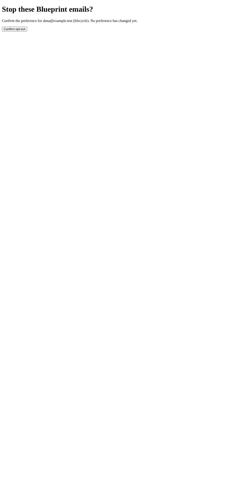
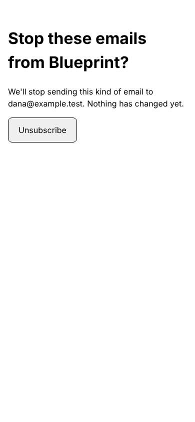

# Launch copy: Emails, every change

The full record behind this part of the launch-copy work: every changed customer-visible string, the screenshots and the test results. Glossary and decisions: [decisions.md](decisions.md).

Part 4 of the launch-copy work. Every email a site or company can receive uses the launch words: job, deployment company, job packet, first look, simulation of your site, responses, Introduce us, Find jobs.

**What changes:**
- Site emails use the button "Open your job"; company emails use "Open the job".
- Introduction emails said "Reply to them directly", which was untrue because a reply goes to Blueprint. They now say to write to the other side at the address given.
- The unsubscribe line no longer leaks the internal scope name ("optional updates emails").
- The unsubscribe page names what it stops.
- The answer labels are built from the form's own labels.
- `docs/qa/launch-copy-audit/emails.md` (before) and `emails-after.md` (after) hold every email, rendered.

This PR also deletes `COMPANY_ANSWERS` from `publicCopy.ts` once part 1 has landed, because nothing else reads it.

## Before / after
Every changed customer-visible string (38). The audit row behind each one, with the test it touched, is in `docs/qa/launch-copy-audit/findings.md` (PR [ognjhunt/Blueprint-WebApp#1365](https://github.com/ognjhunt/Blueprint-WebApp/pull/1365)).

| surface | before | after |
|---|---|---|
| Email job_sent (site) | Your job page shows any answer. | Your job page shows any responses. |
| Email job_sent (site), how to withdraw, filmed job | To stop, open your job page, choose Job settings, then Stop using my video. Your job then leaves every company's view at once. | To withdraw your job, open your job page, choose Job settings, then Stop using my video. It then leaves every company's view at once. Each company it was sent to is asked to delete any copy it saved. |
| Email job_sent (site), how to withdraw, description-only job | To stop, open your job page and choose Withdraw my job. Your job then leaves every company's view at once. | To withdraw your job, open your job page and choose Withdraw my job. It then leaves every company's view at once. Each company it was sent to is asked to delete any copy it saved. |
| Email task_received (site outside the US) | Your job link is ready. / A video is required to post your job. Use the link to send one or check your upload. This link opens your job without a password, so please don't forward it. | Your job is saved. / We can only take videos from sites in the United States for now, so please don't send a video yet. This link opens your job without a password, so please don't forward it. |
| Email company_answered (site), Interested / Tested it: can do | A deployment company answered about your job: Interested. Your job page has the details. | A deployment company answered "Interested" about your job. To meet them, press Introduce us on your job page. (When the button is not offered: '... answered "Interested" about your job. Your job page … |
| Email company_answered (site), Not a fit / Tested it: cannot yet | A deployment company answered about your job: Not a fit. Your job page has the details. | A deployment company answered "Not a fit" about your job. Your job page has the details. |
| Email company_answered (site), Need more details | A deployment company answered about your job: Need more details. Your job page has the details. You can answer a company’s question on your job page. | A deployment company needs more details about your job. Read their question and answer it on your job page. (Recorded by Blueprint from email: '... about your job. Your job page has the details.') |
| Email introduction_made_site (site), first line | Northwind Robotics answered Tested it: can do about your job, and you asked us to introduce you. | Northwind Robotics answered "Tested it: can do" about your job, and you asked us to introduce you. |
| Email introduction_made_site (site), closing | We've given them your details. Reply to them directly. | We've given them your details. Write to them at the email above. |
| Email introduction_made_site fallback body (unused) | We've given them your details. Reply to them directly. | We've given them your details. Their contact details are on your job page. |
| Email site_action_needed (site), subject | Your job needs something from you | The ask's own title: 'Tell us the job in one sentence' / 'Your job is waiting for its video' / 'We need a new video to build the simulation of your site' |
| Email site_action_needed (site), body | We need a new video to build the simulation of your site. Please film a shorter clip, or record at 1080p. Then send us the new video. | Your video is too large for us to process. Please film a shorter clip, or record at 1080p. Then send us the new video. (Body = reason + next step. The first-video reminder has no reason, so its body i… |
| Email job_outcome_question (both sides), answer links | Still talking: https://…/api/job-outcomes/<token> (five 'Label: URL' lines in one paragraph, no buttons) | Still talking:\nhttps://…/api/job-outcomes/<token> (each answer its own paragraph: five labelled buttons) |
| Email job_outcome_question to the company, start-form job | How did it go with 1200 E 6th St, Austin, TX? / Press one to tell us what happened with 1200 E 6th St, Austin, TX. | How did it go with the site at 1200 E 6th St, Austin, TX? / Press one to tell us what happened with the site at 1200 E 6th St, Austin, TX. |
| Email robot_team_access_approved (company), account block | Create your account with this email address (dana@northwind.example), or sign in if you already have one:\nhttps://tryblueprint.io/signup/business?invitation=…\nThis invitation is bound to your approv… | Use this email address (dana@northwind.example) to create your account, or sign in if you already have one.\n\nSet up your account:\nhttps://tryblueprint.io/signup/business?invitation=…\n\nThe link wo… |
| Email robot_team_access_approved (company), where to find jobs | Once you are signed in, the job library at https://tryblueprint.io/contact/robot-team shows the jobs sites share with approved companies. Open a job to see what the site filmed and what we have found … | Once you are signed in, open Find jobs to see the jobs sites have posted. Open a job to see its job packet and respond.\n\nFind jobs:\nhttps://tryblueprint.io/contact/robot-team |
| Email robot_team_access_approved (company), closing | Approval does not guarantee a job, an introduction, or a deployment. Nothing is charged today. | Nothing is charged today. |
| Email robot_team_new_task (company), body | A site is looking for a deployment company for one of its jobs. See the job and answer in a minute: Interested, Not a fit or Need more details; once the simulation can be downloaded, also Tested it: c… | A site has posted a new job. Open it to see the job packet and respond. |
| Email robot_team_new_task (company), button | Open your job page (layout default for a bare URL) | Open the job |
| Email robot_team_new_task (company), alerts line | Approved deployment companies get an email for each new job. Turn these off in Settings or unsubscribe below. | You get this email for each new job. Turn these off in Settings or unsubscribe below. |
| Email robot_team_new_task (company), unsubscribe line | Unsubscribe from optional updates emails: {url} | Unsubscribe from new-job emails and Blueprint updates: {url} |
| Email robot_team_new_task (company), HTML part | Inside the card: -- / postal line / Privacy: https://tryblueprint.io/privacy / Unsubscribe from optional updates emails: <raw URL with the reader's email> | Nothing inside the card. The footer shows 'Questions? Reply to this email or write to hello@tryblueprint.io.' / postal line / 'Unsubscribe' (link). The text part still carries the full footer. |
| Email introduction_made_company (company), opening | You answered Interested to a job on Blueprint, and the site has asked for an introduction. Here are its details: | You answered "Interested" to a job on Blueprint, and the site has asked for an introduction. Here are its details: |
| Email introduction_made_company (company), address lines | Site: {name} … Where it is: {location} (and for a start-form job 'Site: 1200 E 6th St, Austin, TX' with no location line) | Site: {name} … Address: {location} (for a start-form job, no Site line, just 'Address: 1200 E 6th St, Austin, TX') |
| Email introduction_made_company (company), job link | The job: https://tryblueprint.io/jobs/{jobId} | Open the job:\nhttps://tryblueprint.io/jobs/{jobId} (a button) |
| Email introduction_made_company (company), closing | We are sending the site your company's name and your contact details now. Reply to them directly. | We are sending the site your company's name and your contact details now. Write to them at the email above. |
| Email job_clarification (company) | The site added an answer to your question.\n\nView the job:\n{url} | Read it on the job page.\n\nOpen the job:\n{url} |
| Email job_withdrawn_company (company) | A site has withdrawn a job you were sent on November 12, 2026: Pallet handling opportunity. It has left your job library. If you saved its video or its simulation, delete your copy now. | A site has withdrawn a job you were sent on November 12, 2026: Handle pallets. It is no longer listed in Find jobs. If you saved its video or its simulation, delete your copy now. |
| Email film-link handoff (person filming), opening | Someone has asked you to film a job for "{job}". Blueprint turns the video into a job packet and shares it, without sound, with the robot deployment companies it approves, so they can decide whether t… | Someone has asked you to film a job for "{job}". Blueprint turns the video into a job packet. We share it, without sound, with robot deployment companies we've approved, so they can decide if they can… |
| Email film-link handoff (person filming), how-to and link | Open this link on your phone. The recorder opens in your browser. No account is needed, and about thirty seconds of the actual cycle is enough:\n{filmUrl} | Open this link on your phone. The recorder opens in your browser, and no account is needed. One full round of the job, about 30 seconds, is enough.\n\nFilm the job:\n{filmUrl} (a button) |
| Email film-link handoff (person filming), closing | You can record and upload from this link. Confirming the job details stays with the person who sent it to you. | You can record and upload from this link. |
| Email film-link handoff (person filming), layout and sender | Plain text only, from the RESEND_FROM_* sender, Reply-To hello@: no header, no postal footer, no button | Branded layout (header, button, footer, text footer), from and Reply-To Blueprint <hello@tryblueprint.io> |
| Every email with a button (HTML), fallback line | If the button doesn't open, use this link: {button label}. | If the button doesn't work, copy this link: {url} |
| Unsubscribe page (new-job email link), confirm | Stop these Blueprint emails? / Confirm the preference for {email} (optional updates). No preference has changed yet. / [Confirm opt-out] | Unsubscribe from new-job emails and Blueprint updates? / We'll stop sending them to {email}. / [Unsubscribe] (styled page) |
| Unsubscribe page (other scopes), confirm | Stop these Blueprint emails? / Confirm the preference for {email} (lifecycle). No preference has changed yet. / [Confirm opt-out] | Stop these emails from Blueprint? / We'll stop sending this kind of email to {email}. Nothing has changed yet. / [Unsubscribe] |
| Unsubscribe page, done | Your opt-out has been recorded. You will not receive these Blueprint emails. (text/plain) | You're unsubscribed. We won't send you new-job emails or Blueprint updates. (other scopes: You're unsubscribed. We won't send you these emails again.) (styled HTML) |
| Unsubscribe page, errors in a browser | {"ok":false,"error":"Valid email is required"} / {"ok":false,"error":"Confirm the matching email preference before submitting",…} / {"ok":false,"error":"Email preference storage is unavailable"} | This unsubscribe link is incomplete. Use the link in your latest Blueprint email, or write to hello@tryblueprint.io. / This link changed. Open it again from the email. / We couldn't save that just now… |
| Company sign-up /signup/business?invitation=… stale or invalid link | Robot-team signup requires a current Blueprint invitation. Apply and wait for approval. | This invitation link no longer works. Use the link on this page to get a new one. |

## Screenshots
Before: the audit inventory. After: the same harness, run on all four launch-copy branches merged. Desktop is 1280 px wide, phone 390 px.

**email-unsubscribe** (email-link), before → after (phone)

 

| screen | persona | before | after |
|---|---|---|---|
| email-unsubscribe | email-link | [desktop](https://github.com/ognjhunt/Blueprint-WebApp/blob/a0365cb52478434fa1d0d925761851c07887c8ea/docs/qa/launch-copy-audit/screens/email-unsubscribe__email-link__1280.jpg) · [phone](https://github.com/ognjhunt/Blueprint-WebApp/blob/a0365cb52478434fa1d0d925761851c07887c8ea/docs/qa/launch-copy-audit/screens/email-unsubscribe__email-link__390.jpg) | [desktop](https://github.com/ognjhunt/Blueprint-WebApp/blob/a0365cb52478434fa1d0d925761851c07887c8ea/docs/qa/launch-copy-audit/after/email-unsubscribe__email-link__1280.jpg) · [phone](https://github.com/ognjhunt/Blueprint-WebApp/blob/a0365cb52478434fa1d0d925761851c07887c8ea/docs/qa/launch-copy-audit/after/email-unsubscribe__email-link__390.jpg) |

## Fixed in the final read-through
| screen | text | problem | fix |
|---|---|---|---|
| email task_received (start form, site outside the … | A video is required to post your job. Use the link to send one or check your upload. | Untrue and contradictory. The saved screen tells a site outside the US not to send a video, but the first email asks for one. The builder al… | The start form's first email now passes captureRegion, so this site gets 'Your job is saved. We can only take videos from sites in the United States for now, so… |
| email robot_team_new_task | You get this email for each new job. Turn these off in Settings or unsubscribe below. | 'this email' then 'these' is loose; the e-04 fixer flagged it too. | 'You get an email like this for each new job. Turn them off in Settings or unsubscribe below.' Server test and docs/qa/launch-copy-audit/emails-after.md updated… |

## Consent wording changed (owner approval)
None. No recorded statement, acceptance text or legal page changes in this PR. Those wait in a separate consent PR.

## Invented for the demo (replace before launch)
None. Every sentence here describes what the code does today.

## Tests
| check | result | detail |
|---|---|---|
| npm run check | pass | tsc -p tsconfig.full.json --noEmit was clean after all commits. |
| npx vitest run client/tests | pass | 106 files, 1468 tests passed. This includes the strengthened publicClaims guard (10 tests). |
| npx vitest run (server tests for changed files) | pass | 35 server test files for the changed modules passed: company-job-automation, plant-and-prove, job-company-sends, site-emails, approval email, withdrawal notice, terms gate, job-outcomes, site-action-needed, no-grant endi… |
| node scripts/release/checks.mjs test (cloud env sourced) | pre_existing_fail | Scope is 'full', so it runs npm run test:coverage. The only remaining failure is server/tests/firebase-admin-config.test.ts (6 tests): TypeError 'dbAdmin.settings is not a function' at client/src/lib/firebaseAdmin.ts:134… |
| node scripts/release/checks.mjs test (without cloud env) | pass | Exit 0: 461 test files passed, 3 skipped; 6960 tests passed, 6 skipped. |
| npm run claims:guard | pass | No operational proof drift findings. |
| npm run build && npx vitest run client/tests/build-output.test.ts | pass | A plain npm run build stops at verify-client-env because this environment has no VITE_FIREBASE_* values; that is environment, not code. The compile-only build (BLUEPRINT_ALLOW_UNCONFIGURED_CLIENT_BUILD=1) succeeded, and … |
| CI=1 PLAYWRIGHT_PORT=4704 npx playwright test e2e/signup-simple.spec.ts --trace … | pass | 6 passed. No other default-config spec asserts email or unsubscribe text. |
| Merge check against other fixer branches | pass | git merge-tree of launch-copy/emails with launch-copy/public, launch-copy/company and launch-copy/site: all three merge cleanly. |
| Rendered emails after the fixes | pass | All 35 emails were rendered from a scratch merge of launch-copy/emails with launch-copy/site, written to /home/user/Blueprint-WebApp/docs/qa/launch-copy-audit/emails-after.md. The scratch worktree has been removed; nothi… |

The four launch-copy branches were also merged together and checked as one: `npm run check`, `npx vitest run client/tests` (1489 tests), `npm run claims:guard`, and `npm run build` plus the build-output test (14/14) all pass. `npx vitest run server/tests` passes too, except 6 tests in `server/tests/firebase-admin-config.test.ts`. Those fail the same way on `main` ('dbAdmin.settings is not a function', from a cloud-session env variable). The Playwright configs CI doesn't run (workspace, invited-beta, site-reliability, reliability-intake, intake, intake-backend, intake-durability, privacy) are running on the merged branch; results will be added here.
