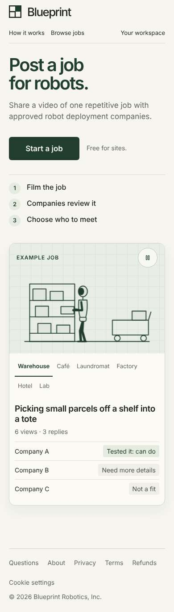
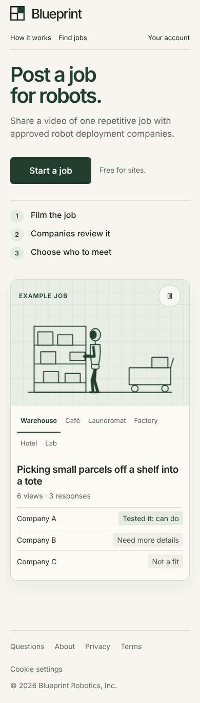
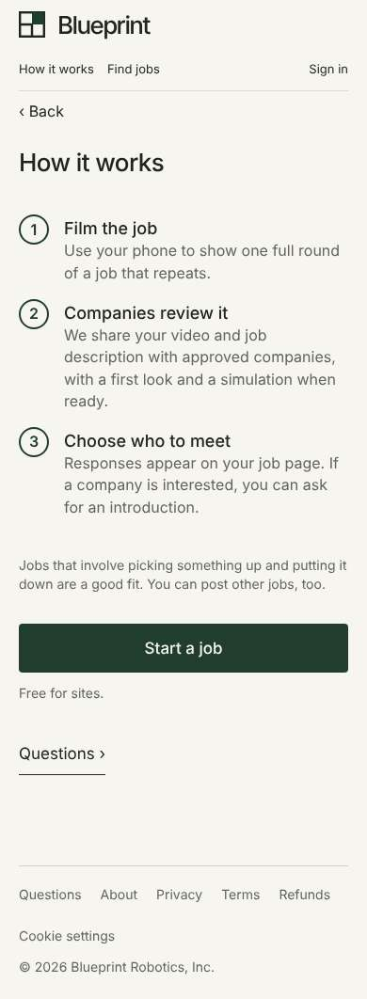
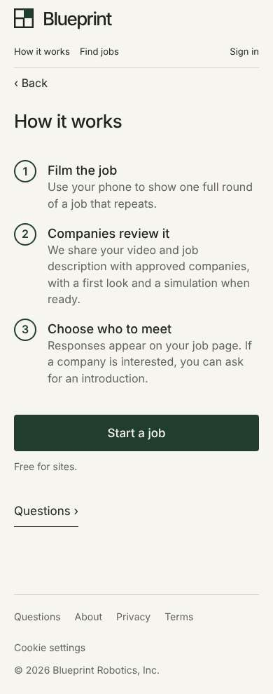
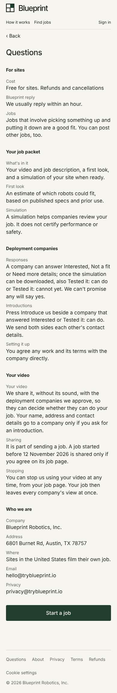
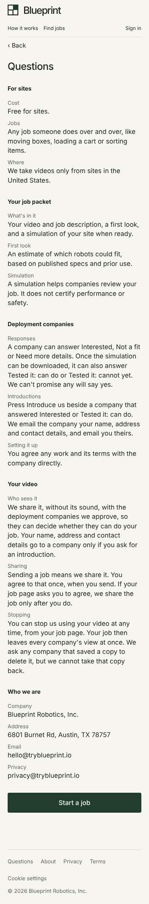
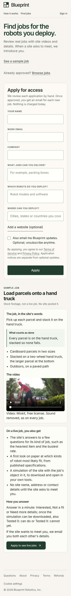
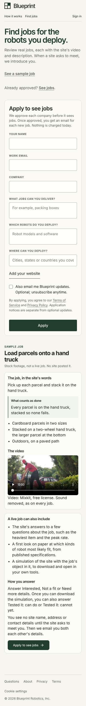

# Launch copy: Public pages, nav, SEO and llms, every change

The full record behind this part of the launch-copy work: every changed customer-visible string, the screenshots and the test results. Glossary and decisions: [decisions.md](decisions.md).

Part 1 of the launch-copy work: the audit, plus the public pages, nav, SEO and llms.

**The audit**, in `docs/qa/launch-copy-audit/`:
- `inventory.md`: 95 customer screens, desktop and phone, with their visible text.
- `emails.md` and `emails-after.md`: every email, before and after.
- `findings.md`: 499 findings after adversarial verification.
- `decisions.md`: the glossary, voice rules, decisions, the REMOVE / REWRITE / KEEP change list, the recorded statements that need the owner, and proposed legal-page edits. The legal pages are not edited.
- `after/`: every changed screen, captured again.

**Public pages:**
- Questions no longer promises "We usually reply within an hour".
- No Refunds link in the footer, beside "Free for sites", or in the sitemap. The page itself stays until the owner decides.
- How it works drops "Jobs that involve picking something up and putting it down are a good fit. You can post other jobs, too." The Questions "Jobs" row now helps instead: "Any job someone does over and over, like moving boxes, loading a cart or sorting items."
- "A job started before 12 November 2026…" is gone. Questions now says plainly what sharing and stopping mean, including that a copy a company already saved is asked to be deleted.
- One way to say the answers.
- The same header and footer links on every layout, and "Your account" for every signed-in account.
- The share image every link shows used to say "Robot teams evaluate your task in simulation. We recommend the one that passed. Free during the beta." It is re-rendered with the home page's title and sub-line.
- `llms.txt` and `llms-full.txt` lose their internal style notes, and the agent page list no longer describes filming visits, evaluations or booking.

## Before / after
Every changed customer-visible string (49). The audit row behind each one, with the test it touched, is in `docs/qa/launch-copy-audit/findings.md` (PR [ognjhunt/Blueprint-WebApp#1365](https://github.com/ognjhunt/Blueprint-WebApp/pull/1365)).

| surface | before | after |
|---|---|---|
| Share image (og:image on every page) | From one recurring task to a measured robot pilot. / Robot teams evaluate your task in simulation. We recommend the one that passed. Free during the beta. | Post a job for robots. / Share a video of one repetitive job with approved robot deployment companies. Free for sites. / tryblueprint.io |
| Share image alt text | Blueprint — From one recurring task to a measured robot pilot. | Blueprint — Post a job for robots. |
| Questions, For sites: Cost | Free for sites. Refunds and cancellations (link) | Free for sites. |
| Questions, For sites: Blueprint reply | We usually reply within an hour. | (row removed) |
| Questions, For sites: Jobs | Jobs that involve picking something up and putting it down are a good fit. You can post other jobs, too. | Any job someone does over and over, like moving boxes, loading a cart or sorting items. |
| Questions, Where (moved from Who we are to For sites) | Sites in the United States film their own job. | We take videos only from sites in the United States. |
| Questions, Deployment companies: Responses | A company can answer Interested, Not a fit or Need more details; once the simulation can be downloaded, also Tested it: can do or Tested it: cannot yet. We can't promise any will say yes. | A company can answer Interested, Not a fit or Need more details. Once the simulation can be downloaded, it can also answer Tested it: can do or Tested it: cannot yet. We can't promise any will say yes… |
| Questions, Deployment companies: Introductions | Press Introduce us beside a company that answered Interested or Tested it: can do. We send both sides each other's contact details. | Press Introduce us beside a company that answered Interested or Tested it: can do. We email the company your name, address and contact details, and email you theirs. |
| Questions, Your video: row label | Your video | Who sees it |
| Questions, Your video: Sharing | It is part of sending a job. A job started before 12 November 2026 is shared only if you agree on its job page. | Sending a job means we share it. You agree to that once, when you send. If your job page asks you to agree, we share the job only after you do. |
| Questions, Your video: Stopping | You can stop us using your video at any time, from your job page. Your job then leaves every company's view at once. | You can stop us using your video at any time, from your job page. Your job then leaves every company's view at once. We ask any company that saved a copy to delete it, but we cannot take that copy bac… |
| Questions SEO description (page, JSON-LD, site-content) | What Blueprint costs a site, how fast we reply, which jobs fit, what deployment companies see and how they respond, what stays private, and who we are. | What Blueprint costs a site, what deployment companies see, how they respond, what stays private, and who we are. |
| How it works: job-fit line | Jobs that involve picking something up and putting it down are a good fit. You can post other jobs, too. | (removed) |
| How it works SEO description (page, JSON-LD, site-content) | Share a video of one repetitive job with approved robot deployment companies. See responses and choose who to meet. Free for sites. | Film one job that repeats. We share it with approved deployment companies. You see their responses and choose who to meet. Free for sites. |
| Find jobs: tab/search title (and site-content /jobs title) | Find jobs \| Blueprint | Find jobs for the robots you deploy \| Blueprint |
| Find jobs: sub-line | Review real jobs with site videos and details. When a site asks to meet, we introduce you. | Review real jobs, each with the site's video and description. When a site asks to meet, we introduce you. |
| Find jobs: approved-company link | Already approved? Browse jobs | Already approved? See jobs. |
| Find jobs SEO description (page, site-content) | Apply to review real robotics jobs with site videos and details. When a site asks to meet, Blueprint introduces you. | For robot deployment companies: apply to see real jobs that sites want robots to do, each with a video. When a site asks to meet, Blueprint introduces you. |
| Company job list SEO description (/contact/robot-team) | Approved robot deployment companies can browse site jobs, watch videos and respond. | Approved robot deployment companies can see jobs, watch videos and respond. |
| Sample job: heading | On a live job, you also get | A live job can also include |
| Sample job: first live item | The site's answers to a few questions for its kind of job, such as the heaviest item and the busiest rate. | The site's answers to a few questions about the job, such as the heaviest item and the peak rate. |
| Sample job: fourth live item | No site name, address or contact details until the site asks to meet you. | (removed; moved into the introduction line) |
| Sample job: how you answer | Answer in a minute: Interested, Not a fit or Need more details; once the simulation can be downloaded, also Tested it: can do or Tested it: cannot yet. | Answer Interested, Not a fit or Need more details. Once you can download the simulation, you can also answer Tested it: can do or Tested it: cannot yet. |
| Sample job: introduction | If the site wants to meet you, we email you both each other's details. | You see no site name, address or contact details until the site asks to meet you. Then we email you both each other's details. |
| Sample job: button | Apply to see live jobs | Apply to see jobs |
| Home example card: counts | {views} views · {n} replies / No answers yet. (aria-label "Example answers") | {views} views · {n} responses / No responses yet. (aria-label "Example responses") |
| 404 page SEO description | This page could not be found. Return to Blueprint to start a job assessment or apply as a partner. | This page could not be found. Go back to Blueprint to start a job or apply as a deployment company. |
| 404 page body line | Let’s get you back to the right place. | (removed) |
| Cookie panel: first category | Necessary — Required for basic site functionality | Essential — Keeps the site working |
| Cookie banner link | Read our privacy policy. | Read our Privacy Policy. |
| Public header, signed-in account link | Finish onboarding (/onboarding) / Your workspace (/app) | Your account (/app) for every account |
| Public header, signed-in nav link | Browse jobs | Find jobs |
| Public footer | Questions · About · Privacy · Terms · Refunds · Cookie settings | Questions · About · Privacy · Terms · Cookie settings |
| Runway header (staff pages, redirects) | How it works · Find jobs · Sign in · Sign up ▸ Choose access path (Robot team: Review scoped site jobs, confirm what your team can support, and focus on credible physical pilots. / Site operator: Star… | How it works · Find jobs · Your account (signed in) or Sign in; the phone menu has the same three links |
| Runway footer (staff pages, redirects) | Post a job for robots. Share a video… / hello@tryblueprint.io; columns Product (How it works, Questions, Start a job, Find jobs), Evidence (About, Privacy, Terms, Refunds), Company (hello@tryblueprint… | Questions · About · Privacy · Terms · Cookie settings · © {year} Blueprint Robotics, Inc. |
| llms.txt / llms-full.txt summary | > Post a job for robots. A site films one job that repeats, once. Blueprint sends the job, as a job packet (what the job is, a first look at which robots could fit, and the simulation of the site once… | > Post a job for robots. A site films one job that repeats. Blueprint turns the video into a job packet: the site's description, the video without sound, a first look at which robots could fit, and a … |
| llms.txt / llms-full.txt page list | - [Questions: cost, jobs that fit, privacy, who we are](…/beta) / - [For deployment companies: apply to receive jobs](https://tryblueprint.io/partners) | - [Questions: cost, what deployment companies see, privacy, who we are](…/beta) / - [Find jobs (deployment companies): apply to see jobs](https://tryblueprint.io/jobs) |
| llms.txt / llms-full.txt apply line | Deployment companies apply on the page for deployment companies. Applications stay pending until Blueprint approves the company by hand; applying does not grant access or promise a job. Contact: hello… | Deployment companies apply at https://tryblueprint.io/jobs. Blueprint approves each company before it sees jobs. Contact: hello@tryblueprint.io. |
| llms.txt / llms-full.txt Evidence boundary | ## Evidence boundary … A Task Evaluation Run returns a decision or abstention. Pipeline owns method qualification and routing; … | (section removed) |
| Agent page list: definitions | Blueprint, Job assessment and pilot coordination, Site sign-up, Exact-site world model, Site-Task Testbed, Decision/Evidence Request, Decision Envelope, Job packet, Evidence routing, Permitted evidenc… | Blueprint, Site sign-up, Job packet |
| Agent page list: Site sign-up | … Partner applications are reviewed before access. Starting a job is not a signed order or a commitment to run a pilot; the site confirms the brief and agrees any pilot terms with the deployment compa… | Sign-up is open for sites: anyone can start a job with an email, where the job is, and a video of the job. Deployment companies apply, and Blueprint approves each company before it sees jobs. Any work… |
| Agent page list: Privacy / Terms descriptions | Blueprint privacy policy for site capture, in-person filming visits, simulated evaluations, AI processing and California privacy rights. / Blueprint terms for the free beta: site capture, evaluations,… | How Blueprint Robotics, Inc. collects, uses and protects information on tryblueprint.io and in the Blueprint service. / The terms for using Blueprint, from Blueprint Robotics, Inc. |
| Agent page list: query themes | measured physical robot pilot, free robot pilot recommendation, … claim ceiling robot evaluation, post-training eligible evidence, … (19 themes) | post a job for robots, robot deployment companies, automate a repetitive job with a robot, find jobs for the robots you deploy, simulation of a site for robot deployment |
| Agent page list: safety line | This endpoint only returns public, non-sensitive summaries. Do not infer customer results, ratings, prices, live payment state, … or package proof beyond owner-system evidence. | This endpoint returns public summaries only. |
| Agent page list: Blueprint summary (answers clause) | A company can answer Interested, Not a fit or Need more details; once the simulation can be downloaded, also Tested it: can do or Tested it: cannot yet, and any work is agreed between the site and the… | A company can answer Interested, Not a fit or Need more details. Once the simulation can be downloaded, it can also answer Tested it: can do or Tested it: cannot yet. Any work is agreed between the si… |
| robots.txt comments | Search crawlers are allowed for public buyer pages. / … cite Blueprint's public buyer pages … / … cite public buyer pages. | Search crawlers are allowed for public pages. / … cite Blueprint's public pages … / … cite public pages. |
| Sitemap | … /privacy, /terms, /refunds | … /privacy, /terms (no /refunds) |
| Redirect /faq | /faq → /#how-it-works | /faq → /beta (Questions) |
| /app/captures (capture upload and review page) | Any signed-in account: 'Upload capture files for your jobs, then follow each one through review.', Scene ID, Plan the 3D scene, Approve the plan, Final cost is pending. | Staff only (admin/ops). Other accounts are sent to the home page. |

## Screenshots
Before: the audit inventory. After: the same harness, run on all four launch-copy branches merged. Desktop is 1280 px wide, phone 390 px.

**home** (staff), before → after (phone)

 

**how-it-works** (signed-out), before → after (phone)

 

**questions-beta** (signed-out), before → after (phone)

 

**find-jobs** (signed-out), before → after (phone)

 

| screen | persona | before | after |
|---|---|---|---|
| cookie-banner | signed-out | [desktop](https://github.com/ognjhunt/Blueprint-WebApp/blob/a0365cb52478434fa1d0d925761851c07887c8ea/docs/qa/launch-copy-audit/screens/cookie-banner__signed-out__1280.jpg) · [phone](https://github.com/ognjhunt/Blueprint-WebApp/blob/a0365cb52478434fa1d0d925761851c07887c8ea/docs/qa/launch-copy-audit/screens/cookie-banner__signed-out__390.jpg) | [desktop](https://github.com/ognjhunt/Blueprint-WebApp/blob/a0365cb52478434fa1d0d925761851c07887c8ea/docs/qa/launch-copy-audit/after/cookie-banner__signed-out__1280.jpg) · [phone](https://github.com/ognjhunt/Blueprint-WebApp/blob/a0365cb52478434fa1d0d925761851c07887c8ea/docs/qa/launch-copy-audit/after/cookie-banner__signed-out__390.jpg) |
| find-jobs | signed-out | [desktop](https://github.com/ognjhunt/Blueprint-WebApp/blob/a0365cb52478434fa1d0d925761851c07887c8ea/docs/qa/launch-copy-audit/screens/find-jobs__signed-out__1280.jpg) · [phone](https://github.com/ognjhunt/Blueprint-WebApp/blob/a0365cb52478434fa1d0d925761851c07887c8ea/docs/qa/launch-copy-audit/screens/find-jobs__signed-out__390.jpg) | [desktop](https://github.com/ognjhunt/Blueprint-WebApp/blob/a0365cb52478434fa1d0d925761851c07887c8ea/docs/qa/launch-copy-audit/after/find-jobs__signed-out__1280.jpg) · [phone](https://github.com/ognjhunt/Blueprint-WebApp/blob/a0365cb52478434fa1d0d925761851c07887c8ea/docs/qa/launch-copy-audit/after/find-jobs__signed-out__390.jpg) |
| find-jobs-applied | signed-out | [desktop](https://github.com/ognjhunt/Blueprint-WebApp/blob/a0365cb52478434fa1d0d925761851c07887c8ea/docs/qa/launch-copy-audit/screens/find-jobs-applied__signed-out__1280.jpg) · [phone](https://github.com/ognjhunt/Blueprint-WebApp/blob/a0365cb52478434fa1d0d925761851c07887c8ea/docs/qa/launch-copy-audit/screens/find-jobs-applied__signed-out__390.jpg) | [desktop](https://github.com/ognjhunt/Blueprint-WebApp/blob/a0365cb52478434fa1d0d925761851c07887c8ea/docs/qa/launch-copy-audit/after/find-jobs-applied__signed-out__1280.jpg) · [phone](https://github.com/ognjhunt/Blueprint-WebApp/blob/a0365cb52478434fa1d0d925761851c07887c8ea/docs/qa/launch-copy-audit/after/find-jobs-applied__signed-out__390.jpg) |
| find-jobs-errors | signed-out | [desktop](https://github.com/ognjhunt/Blueprint-WebApp/blob/a0365cb52478434fa1d0d925761851c07887c8ea/docs/qa/launch-copy-audit/screens/find-jobs-errors__signed-out__1280.jpg) · [phone](https://github.com/ognjhunt/Blueprint-WebApp/blob/a0365cb52478434fa1d0d925761851c07887c8ea/docs/qa/launch-copy-audit/screens/find-jobs-errors__signed-out__390.jpg) | [desktop](https://github.com/ognjhunt/Blueprint-WebApp/blob/a0365cb52478434fa1d0d925761851c07887c8ea/docs/qa/launch-copy-audit/after/find-jobs-errors__signed-out__1280.jpg) · [phone](https://github.com/ognjhunt/Blueprint-WebApp/blob/a0365cb52478434fa1d0d925761851c07887c8ea/docs/qa/launch-copy-audit/after/find-jobs-errors__signed-out__390.jpg) |
| home | signed-out | [desktop](https://github.com/ognjhunt/Blueprint-WebApp/blob/a0365cb52478434fa1d0d925761851c07887c8ea/docs/qa/launch-copy-audit/screens/home__signed-out__1280.jpg) · [phone](https://github.com/ognjhunt/Blueprint-WebApp/blob/a0365cb52478434fa1d0d925761851c07887c8ea/docs/qa/launch-copy-audit/screens/home__signed-out__390.jpg) | [desktop](https://github.com/ognjhunt/Blueprint-WebApp/blob/a0365cb52478434fa1d0d925761851c07887c8ea/docs/qa/launch-copy-audit/after/home__signed-out__1280.jpg) · [phone](https://github.com/ognjhunt/Blueprint-WebApp/blob/a0365cb52478434fa1d0d925761851c07887c8ea/docs/qa/launch-copy-audit/after/home__signed-out__390.jpg) |
| home | staff | [desktop](https://github.com/ognjhunt/Blueprint-WebApp/blob/a0365cb52478434fa1d0d925761851c07887c8ea/docs/qa/launch-copy-audit/screens/home__staff__1280.jpg) · [phone](https://github.com/ognjhunt/Blueprint-WebApp/blob/a0365cb52478434fa1d0d925761851c07887c8ea/docs/qa/launch-copy-audit/screens/home__staff__390.jpg) | [desktop](https://github.com/ognjhunt/Blueprint-WebApp/blob/a0365cb52478434fa1d0d925761851c07887c8ea/docs/qa/launch-copy-audit/after/home__staff__1280.jpg) · [phone](https://github.com/ognjhunt/Blueprint-WebApp/blob/a0365cb52478434fa1d0d925761851c07887c8ea/docs/qa/launch-copy-audit/after/home__staff__390.jpg) |
| how-it-works | signed-out | [desktop](https://github.com/ognjhunt/Blueprint-WebApp/blob/a0365cb52478434fa1d0d925761851c07887c8ea/docs/qa/launch-copy-audit/screens/how-it-works__signed-out__1280.jpg) · [phone](https://github.com/ognjhunt/Blueprint-WebApp/blob/a0365cb52478434fa1d0d925761851c07887c8ea/docs/qa/launch-copy-audit/screens/how-it-works__signed-out__390.jpg) | [desktop](https://github.com/ognjhunt/Blueprint-WebApp/blob/a0365cb52478434fa1d0d925761851c07887c8ea/docs/qa/launch-copy-audit/after/how-it-works__signed-out__1280.jpg) · [phone](https://github.com/ognjhunt/Blueprint-WebApp/blob/a0365cb52478434fa1d0d925761851c07887c8ea/docs/qa/launch-copy-audit/after/how-it-works__signed-out__390.jpg) |
| legal-update-banner | signed-out | [desktop](https://github.com/ognjhunt/Blueprint-WebApp/blob/a0365cb52478434fa1d0d925761851c07887c8ea/docs/qa/launch-copy-audit/screens/legal-update-banner__signed-out__1280.jpg) · [phone](https://github.com/ognjhunt/Blueprint-WebApp/blob/a0365cb52478434fa1d0d925761851c07887c8ea/docs/qa/launch-copy-audit/screens/legal-update-banner__signed-out__390.jpg) | [desktop](https://github.com/ognjhunt/Blueprint-WebApp/blob/a0365cb52478434fa1d0d925761851c07887c8ea/docs/qa/launch-copy-audit/after/legal-update-banner__signed-out__1280.jpg) · [phone](https://github.com/ognjhunt/Blueprint-WebApp/blob/a0365cb52478434fa1d0d925761851c07887c8ea/docs/qa/launch-copy-audit/after/legal-update-banner__signed-out__390.jpg) |
| not-found | signed-out | [desktop](https://github.com/ognjhunt/Blueprint-WebApp/blob/a0365cb52478434fa1d0d925761851c07887c8ea/docs/qa/launch-copy-audit/screens/not-found__signed-out__1280.jpg) · [phone](https://github.com/ognjhunt/Blueprint-WebApp/blob/a0365cb52478434fa1d0d925761851c07887c8ea/docs/qa/launch-copy-audit/screens/not-found__signed-out__390.jpg) | [desktop](https://github.com/ognjhunt/Blueprint-WebApp/blob/a0365cb52478434fa1d0d925761851c07887c8ea/docs/qa/launch-copy-audit/after/not-found__signed-out__1280.jpg) · [phone](https://github.com/ognjhunt/Blueprint-WebApp/blob/a0365cb52478434fa1d0d925761851c07887c8ea/docs/qa/launch-copy-audit/after/not-found__signed-out__390.jpg) |
| privacy | signed-out | [desktop](https://github.com/ognjhunt/Blueprint-WebApp/blob/a0365cb52478434fa1d0d925761851c07887c8ea/docs/qa/launch-copy-audit/screens/privacy__signed-out__1280.jpg) · [phone](https://github.com/ognjhunt/Blueprint-WebApp/blob/a0365cb52478434fa1d0d925761851c07887c8ea/docs/qa/launch-copy-audit/screens/privacy__signed-out__390.jpg) | [desktop](https://github.com/ognjhunt/Blueprint-WebApp/blob/a0365cb52478434fa1d0d925761851c07887c8ea/docs/qa/launch-copy-audit/after/privacy__signed-out__1280.jpg) · [phone](https://github.com/ognjhunt/Blueprint-WebApp/blob/a0365cb52478434fa1d0d925761851c07887c8ea/docs/qa/launch-copy-audit/after/privacy__signed-out__390.jpg) |
| questions-beta | signed-out | [desktop](https://github.com/ognjhunt/Blueprint-WebApp/blob/a0365cb52478434fa1d0d925761851c07887c8ea/docs/qa/launch-copy-audit/screens/questions-beta__signed-out__1280.jpg) · [phone](https://github.com/ognjhunt/Blueprint-WebApp/blob/a0365cb52478434fa1d0d925761851c07887c8ea/docs/qa/launch-copy-audit/screens/questions-beta__signed-out__390.jpg) | [desktop](https://github.com/ognjhunt/Blueprint-WebApp/blob/a0365cb52478434fa1d0d925761851c07887c8ea/docs/qa/launch-copy-audit/after/questions-beta__signed-out__1280.jpg) · [phone](https://github.com/ognjhunt/Blueprint-WebApp/blob/a0365cb52478434fa1d0d925761851c07887c8ea/docs/qa/launch-copy-audit/after/questions-beta__signed-out__390.jpg) |
| refunds | signed-out | [desktop](https://github.com/ognjhunt/Blueprint-WebApp/blob/a0365cb52478434fa1d0d925761851c07887c8ea/docs/qa/launch-copy-audit/screens/refunds__signed-out__1280.jpg) · [phone](https://github.com/ognjhunt/Blueprint-WebApp/blob/a0365cb52478434fa1d0d925761851c07887c8ea/docs/qa/launch-copy-audit/screens/refunds__signed-out__390.jpg) | [desktop](https://github.com/ognjhunt/Blueprint-WebApp/blob/a0365cb52478434fa1d0d925761851c07887c8ea/docs/qa/launch-copy-audit/after/refunds__signed-out__1280.jpg) · [phone](https://github.com/ognjhunt/Blueprint-WebApp/blob/a0365cb52478434fa1d0d925761851c07887c8ea/docs/qa/launch-copy-audit/after/refunds__signed-out__390.jpg) |
| terms | signed-out | [desktop](https://github.com/ognjhunt/Blueprint-WebApp/blob/a0365cb52478434fa1d0d925761851c07887c8ea/docs/qa/launch-copy-audit/screens/terms__signed-out__1280.jpg) · [phone](https://github.com/ognjhunt/Blueprint-WebApp/blob/a0365cb52478434fa1d0d925761851c07887c8ea/docs/qa/launch-copy-audit/screens/terms__signed-out__390.jpg) | [desktop](https://github.com/ognjhunt/Blueprint-WebApp/blob/a0365cb52478434fa1d0d925761851c07887c8ea/docs/qa/launch-copy-audit/after/terms__signed-out__1280.jpg) · [phone](https://github.com/ognjhunt/Blueprint-WebApp/blob/a0365cb52478434fa1d0d925761851c07887c8ea/docs/qa/launch-copy-audit/after/terms__signed-out__390.jpg) |

## Fixed in the final read-through
| screen | text | problem | fix |
|---|---|---|---|
| company-job (layout account link), client test | Your workspace (test expectation) | Cross-branch breakage. The public branch changed every layout's signed-in link to 'Your account' (d-069), but CompanyJob.test.tsx:40 still e… | The test now expects 'Your account'. It was committed on the public branch, whose layout change caused it, so each branch stays green on its own. The company br… |

## Consent wording changed (owner approval)
None. No recorded statement, acceptance text or legal page changes in this PR. Those wait in a separate consent PR.

## Invented for the demo (replace before launch)
None. Every sentence here describes what the code does today.

## Tests
| check | result | detail |
|---|---|---|
| npm run check | pass | tsc -p tsconfig.full.json --noEmit is clean on the final branch. |
| npx vitest run client/tests | fail | One failure: client/tests/pages/CompanyJob.test.tsx:40 still expects 'Your workspace', and the layout now says 'Your account' (d-069). The task says that file belongs to the company branch, so I left it and filed a cross… |
| npx vitest run server/tests/site-content-route.test.ts server/tests/robot-team-a… | pass | 3 files, 112 tests passed. These cover site-content.ts, captureGroundedLanguage and publicCopy (COMPANY_ANSWERS value unchanged). |
| node scripts/release/checks.mjs test | pre_existing_fail | Ran in full scope (npm run test:coverage): 7 failed, 6942 passed. 6 are in server/tests/firebase-admin-config.test.ts and fail the same way on origin/main 497a9d2ad (6 failed, 4 passed, checked on a detached checkout of … |
| npm run claims:guard | pass | No operational proof drift findings. llms.txt and llms-full.txt are scanned as agent_public_text. |
| npm run build && npx vitest run client/tests/build-output.test.ts | pass | The build needs BLUEPRINT_ALLOW_UNCONFIGURED_CLIENT_BUILD=1 here (VITE_FIREBASE_* are unset; compile-only). build-output passes 13/13. Prerendered /how-it-works, /beta and /jobs carry the new descriptions and titles, the… |
| Playwright default config, port 4701: home, site-led-public, privacy-pages, cook… | pre_existing_fail | 35 passed, 1 skipped, 1 failed. The failure is cookie-consent.spec.ts:53 'optional analytics stays off…' (no analytics request after opting in), and it fails the same way on origin/main 497a9d2ad on the same port. |

The four launch-copy branches were also merged together and checked as one: `npm run check`, `npx vitest run client/tests` (1489 tests), `npm run claims:guard`, and `npm run build` plus the build-output test (14/14) all pass. `npx vitest run server/tests` passes too, except 6 tests in `server/tests/firebase-admin-config.test.ts`. Those fail the same way on `main` ('dbAdmin.settings is not a function', from a cloud-session env variable). The Playwright configs CI doesn't run (workspace, invited-beta, site-reliability, reliability-intake, intake, intake-backend, intake-durability, privacy) are running on the merged branch; results will be added here.
