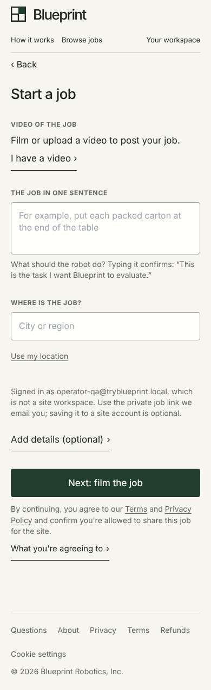
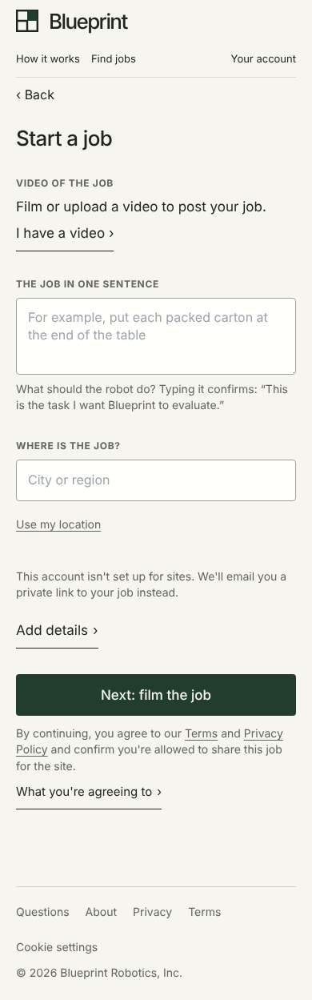
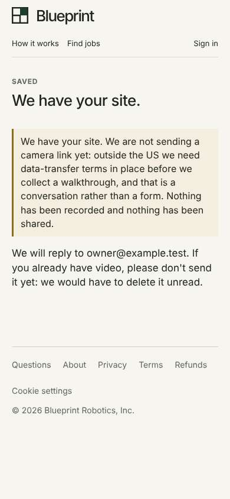
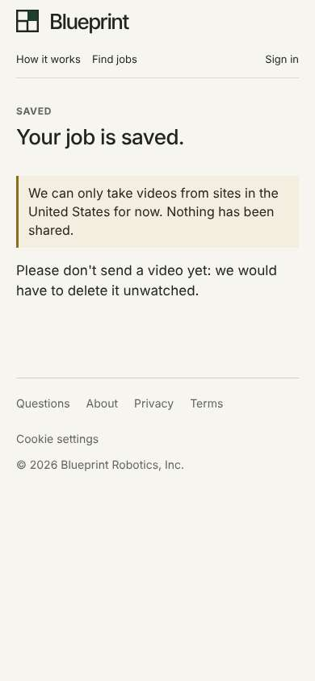
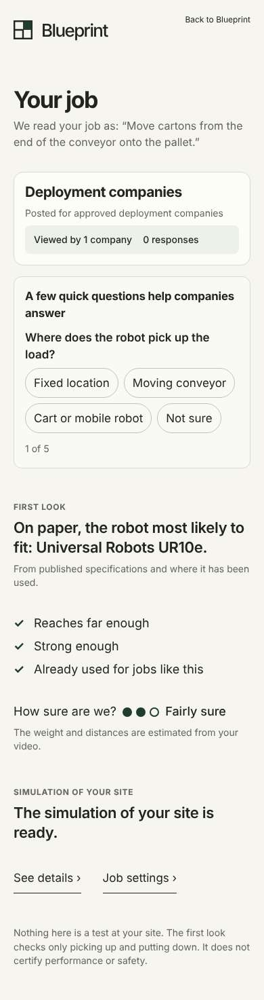
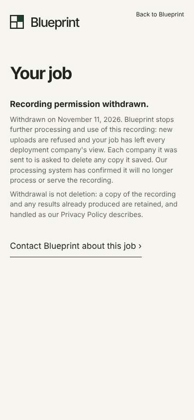
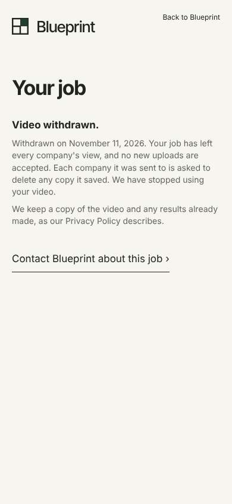

# Launch copy: Site flow and job page statuses, every change

The full record behind this part of the launch-copy work: every changed customer-visible string, the screenshots and the test results. Glossary and decisions: [decisions.md](decisions.md).

Part 2 of the launch-copy work. The site's start form, its private job page, and every status, outcome, request and ending a site can see, in plain words. Each one says what happens next, or "Nothing is needed from you."

**What changes:**
- No line implies a person reviews the job, and none says Blueprint tests robots or mentions a spending cap.
- "recording", "scene" and "brief" become "video", "simulation of your site" and "job description".
- The job reference appears only when a start fails, with the reason it is shown.
- The development-only Claude/Sol consent boxes no longer render in production. A public `?authoring=` link used to show them. They now exist only in development builds; a new build-output test checks the shipped bundle, and the recorded text is unchanged.
- The viewer's own email is no longer shown before they submit.

## Before / after
Every changed customer-visible string (87). The audit row behind each one, with the test it touched, is in `docs/qa/launch-copy-audit/findings.md` (PR [ognjhunt/Blueprint-WebApp#1365](https://github.com/ognjhunt/Blueprint-WebApp/pull/1365)).

| surface | before | after |
|---|---|---|
| Start form: loading | Loading your account and saved draft… | Loading… |
| Start form: development consent boxes (?authoring=) | The two development 3D-authoring consent boxes render on a public ?authoring= link; legacy signup links forward ?authoring= | Rendered (and their consent fields sent) only in a development build; recorded 2026-09-24.v1 text unchanged; signup links no longer forward it |
| Start form: browser cannot keep the submission | error.message as thrown (e.g. "Durable browser storage is unavailable") | This browser can't save your job before sending it, so nothing was sent. Try another browser, or email hello@tryblueprint.io. |
| Start form: confirmation not kept | Your job may already be saved, but this browser could not retain its confirmation. Recover the same job here or use your emailed private link before sending the video. | Your job may already be saved. Open the private link we emailed you to check before you send the video. |
| Start form done: account not set up for sites | This account is not a site workspace, so this site is saved to the link we email {email}. You can claim it from that link later. | This account isn't set up for sites, so we saved this job to the private link we emailed to {email}. You can save it to a site account from that link. |
| Start form done: account links | Saved in your workspace / Save to an account | Saved to your account / Save to my account |
| Start form done: outside the US | We have your site. + We have your site. We are not sending a camera link yet: outside the US we need data-transfer terms in place before we collect a walkthrough, and that is a conversation rather tha… | Your job is saved. + We can only take videos from sites in the United States for now. Nothing has been recorded or shared. + Please don't send a video yet: we would have to delete it unwatched. |
| Start form: country outside the US | During the beta we can only take walkthroughs from sites in the United States. Outside the US we need data-transfer terms signed before you record anything, so tell us about the site and we will start… | We can only take videos from sites in the United States for now. You can save your job, but please don't film or send a video yet. |
| Start form: upload area outside the US | Hold on to the video for now. Outside the US we set up the data-transfer terms before anything is uploaded, and we will tell you when to send it. | (removed; the notice under the country says it once) |
| Start form done: video sent, processing pending | Blueprint will continue from this saved recording and update your job. You can leave this page. | We'll continue from your saved video and update your job. You can leave this page. |
| Start form done and job page: processing disclosure | Processing details (optional) / Retry processing / Retrying processing… (settings rows: Processing / Processing details) | Processing status / Start processing again / Starting… (settings rows: Processing status / Earlier video notes) |
| Start form done: existing video | Send us what you have. / Upload the video you already have through your job page. If more of the work area is needed, you can send a new video on the same job. Your original video stays saved. / Open … | Send us your video. / Upload your video on your job page. / Upload the video |
| Start form done and job page: another device | Open this job on another device (optional) / Use this only if your video is on another device. (job page: Use this if your existing video is on another device. This opens the same job; no new recordin… | Video on another device? / Scan this code with that device to open this job there. |
| Start form done: no link returned | We have your site. / We will reply to {email} with the link to film or upload the video. | Your job is saved. / We'll email the link to film or upload your video to {email}. |
| Start form: form name (screen readers) | Start a site capture | Start a job |
| Start form: saved/recover notice | Your job is saved. Return to the same job to check its current status. / This submission may already be saved. Recover the same job before starting another. / Job reference: {id} | Your job is saved. Return to it to see where it stands. / Your job may already be saved. Recover it before you start another. / (reference removed) |
| Start form: storage notice | This browser cannot safely save or coordinate recovery details. Use a supported browser with local storage enabled, or email hello@tryblueprint.io for help starting your job. If your job is already sa… | This browser can't save your progress. Try another browser, or email hello@tryblueprint.io. If your job is already saved, open the private link we emailed you. |
| Start form: signed-in helper | Saving to your workspace as {email}. / Signed in as {email}, which is not a site workspace. Use the private job link we email you; saving it to a site account is optional. | This job will be saved to your account. / This account isn't set up for sites. We'll email you a private link to your job instead. |
| Start form: Add details helper | Submitting does not authorize spending. | (removed) |
| Start form: failure reference | Job reference: {id} | If this keeps happening, email hello@tryblueprint.io and include this reference: {id} |
| Start form: What you're agreeing to | If you write the job in one sentence / Also: Our Terms and Privacy Policy. We don't share your name, address or contact details unless you ask for an introduction. | The job in one sentence / Your details: We don't share your name, address or contact details unless you ask for an introduction. |
| Upload notice (start form and job page) | Only upload footage you may share. People in it must know it goes to Blueprint and to deployment companies we approve. Avoid conversations: we remove the sound. | Only upload a video you may share. People in it must know it goes to Blueprint and to deployment companies we approve. Avoid conversations: we remove the sound. |
| Job page: robot-fit hold outcome | The simulation is held: none of the robots we can simulate fits this job yet / None of the {n} robot setups we can simulate fits this job. The main reason: {reach \| robot software we run \| GPU memor… | The simulation is on hold: none of the robots we checked fits this job / None of the {n} robots we checked fits this job. [reach only:] The main reason: the spot where the object is picked up or put d… |
| Job page: carry path outcome | The checked robot configuration was rejected / No collision-free pickup-to-placement path was found for the Franka configuration, top-down grasp and bounded set of stations checked. Paid construction … | The robot arm we checked has no clear path for this job / In the simulation of your site, the arm we checked could not carry the object from where it starts to where it goes without hitting something.… |
| Job page: planner held back | We could not confirm the 3D scene covers your job / The views in your video did not show enough of the scene for this job. / Nothing is needed from you now. Your recording stays saved. | Your video didn't show enough of the job / The views in your video did not show enough of the work area for this job. / Nothing is needed from you now. Your video stays saved. |
| Job page: processing failure (fallback) | Blueprint could not finish processing this attempt / A processing step stopped before a usable robot evaluation was produced… / This preparation attempt only. No robot pass, failure or physical-world … | We could not finish preparing your job / A step on our side stopped before it finished. / (no scope line) / Nothing is needed from you. Your video is saved; you don't need to send it again. |
| Job page: not enough evidence | There is not enough evidence for a robot decision / four engineering reasons (retained task geometry, scene-preparation plan, task subject binding, registered geometry) / The current capture and task … | We couldn't build the simulation of your site / We could not rebuild the work area and the object clearly enough to build the simulation. / Nothing is needed from you. Your video is saved. |
| Job page: saved views still to use | Blueprint needs to finish reconstructing the saved video / Blueprint identified useful views in your saved video that still need to be incorporated into the reconstruction. / …before proposing generat… | We haven't finished building the simulation from your video / Part of your video still needs to go into the simulation. / Nothing is needed from you. Your video is saved. |
| Job page and site_action_needed email: tell us the job | Write it at the top of your job page, for example "Pick up each box and put it on the shelf." We start as soon as you send it. | Write it in the box on your job page, for example “Pick up each box and put it on the shelf.” Once you send it, we'll start building the simulation of your site. |
| Job page: unknown outcome | Preparing the simulation of your site stopped, for a reason this page cannot show yet. Our team is alerted when this happens. / We'll email you if anything is needed from you. Your recording is saved. | Preparing the simulation of your site stopped on our side. / Nothing is needed from you. Your video is saved. |
| Job page and email: early task hold detail | No robot was tested in a simulation of your job, and this is not a finding that a robot could not do it. Your first look stays on your job page. | This says nothing about whether a robot could do the job. Your first look stays on your job page. |
| Job page and email: window ended | The simulation of your site has stopped because the time Blueprint was authorized to work on this job ran out. Blueprint did not finish the simulation in that time, and no more simulation work will ru… | The simulation of your site has stopped because the time for this job ran out. It was not finished, and no more work will run on this job. Your first look stays on your job page. To try again, start a… |
| Job page: authority ended | This job has ended because Blueprint is no longer authorized to work on it. Nothing more is needed from you. Keep your original recording; to have Blueprint work on this site again, you can start a ne… | This job has ended because we no longer have permission to work on it. To try again, start a new job. |
| Job page and email: no-grant endings | This job has ended because we did not receive what was needed to start it while it was open. To have Blueprint work on this site, you can start a new job. / This job has ended because the video we rec… | This job has ended because we didn't receive what we needed to start it. To try again, start a new job. / This job has ended because your video was too large for us to process and no new video arrived… |
| Job page, upload refusal, email: video before account | Your video arrived before this job was saved to an account, so we can't use it to build your scene yet. Blueprint needs to review this older recording. You don't need to send it again. (+ Create an ac… | Your video arrived before this job was saved to an account, so we can't use it. To go ahead, start a new job. (account links hidden on that hold) |
| Job page and email: capacity ending | We could not start or finish preparing your job in time, for a reason on our side. Nothing you did caused it(, and it says nothing about whether a robot suits your site). | We couldn't finish preparing your job. The problem was on our side, not yours. (headline: We couldn't finish preparing your job, and we have stopped trying. The problem was on our side, not yours.) |
| Job page outcome card: scope, labels, evidence | Scope caveat on every card / "Next step — Blueprint:" label / Evidence references (Reference: bp-prep-…, label: sha256:…) / region "Preparation outcome" | Scope only for estimates (fit hold, carry path) and the spending-cap card / Blueprint steps unlabelled, the site's own step "Next:" / no evidence references / region "Where your job stands" |
| Job page: withdrawn | Your video is saved. Recording consent was withdrawn, so we can no longer review the video or show the scene preview. | Permission to use your video was withdrawn. Companies can no longer see your job. |
| Job page: none of the objects | Object selection needs review / The owner rejected the suggested objects. Earlier results used that selection. / The task object in this job's saved video. / …Blueprint owns the next review; you can a… | None of the suggested objects was right / You told us none of these is the object the job moves. Earlier results used one of them. / Nothing is needed from you. If you like, describe the object in you… |
| Job page: older evaluation/screening run records | No evaluation of your job has passed yet… / Evaluations on your job have finished, but none can support a recommendation yet… / Results are in from {n} screening runs… + Review the results. / Robot sc… | The simulation of your site is ready. Nothing is needed from you. |
| Job page: posted job | Your job is open for evaluation. Next, Blueprint tests robots and policies on it in simulation. Approved partners can also ask to have their systems evaluated. | Your job is posted for approved deployment companies. Nothing is needed from you. |
| Job page: previews | Your 3D preview is ready. Blueprint is checking the next processing step. / Your scene preview is ready. (prefix) / Your scene preview is ready. We are preparing the job for simulation. / We can asses… | A preview of your site is ready. We're working on the next step. / A preview of your site is ready. (prefix) / A preview of your site is ready. We're preparing the simulation. / Your video covers the … |
| Job page: preparation headlines | We are preparing your job. Keep your original recording. / Job preparation needs more information. Keep your original recording. Nothing is needed from you now. / Your recording is saved and your job … | We are preparing your job. Nothing is needed from you. / We are still preparing your job. Nothing is needed from you now. / Your video is saved and your job is in line for processing on our side. Noth… |
| Job page: preview failure, overdue, scene ended, scene wait | Scene preview preparation could not finish. Our team needs to review it. Keep your original recording. / Your recording is saved. Preparing it is taking longer than it should and needs review… / {Your… | We could not finish building the simulation of your site. Nothing is needed from you. / Your video is saved. Preparing it is taking longer than usual. You don't need to send it again. / We could not f… |
| Job page: first look | Your robot fit check is ready: the robots that fit your job on paper are listed below. It is an estimate from published specs and your video; no robot has been tried on this job. / Blueprint could not… | Your first look is ready: the robots that could fit your job on paper are listed below. It is an estimate from published specs and your video. / We could not give a first look for this job. The reason… |
| Job page: legacy screen states | Not yet. One of your answers means a robot evaluation wouldn't be reliable at this site today, so we aren't building a scene. + Open your job brief… / A few operating details still affect the assessme… | We aren't building a simulation of your site for now, because of one of your answers. + Your job description shows which one. If it changes, update it there. / A few questions about your site are stil… |
| Job page: confirm description / record | Your job brief is ready. Confirm it so we can evaluate your job; you can confirm it before or after you film. + Open your job brief, check the summary and answers, correct anything that is wrong, and … | Check your job description and confirm it. You can do this before or after you film. + Open your job description, fix anything wrong and confirm it. / Film the job from your private job link. |
| Job page: ending reasons | We could not read this recording. / This job is outside what the beta can build a scene for. / {reason} Automatic preparation retries have stopped.{ended} | We could not read this video. / We can't simulate this kind of job yet. / {reason}{ended} |
| Job page and email: simulation holds | The simulation can't model this kind of task yet. It counts as demand for what we build next. / A problem on our side stopped the simulation before it finished. Our team has been told, and we'll email… | We can't simulate this kind of job yet. / A problem on our side stopped the simulation before it finished. / We couldn't finish the simulation of your site: it didn't pass one of our checks. / Held on… |
| Job page and email: simulation lines | You closed this job's simulation run. / The simulation of your job stopped, for a reason this page cannot show yet. (Our team is alerted when this happens.) / We reached our spending cap for this job,… | You closed this job. / We stopped building the simulation of your site. / We stopped building the simulation of your site before it was finished. / We could not finish the simulation of your site. / A… |
| Job page and confirm reply: unclear brief | Your job brief needs one sentence about the job before we can evaluate it. / From your job brief, we could not tell what the job is. / Describe the job in one sentence at the top of your job brief and… | Tell us the job in one sentence. / We couldn't tell what the job is from your description. / Write it in one sentence in your job description and confirm it. |
| Job page: held link details | Still resting on inferred answers: {field ids}. The operator has to confirm these before anything is captured. / The site is outside the region the beta is cleared to collect from. Transfer terms have… | Some details about your job still need your confirmation before you film. Check and confirm your job description. / We can only take videos from sites in the United States for now, so this link can't … |
| Job page: upload holds | Your original file is saved, but we could not read its video stream. Update the walkthrough on this job or contact Blueprint for help. / Your video is saved. Processing is on hold until its existing c… | Your original file is saved, but we couldn't read the video in it. Choose Send a new video on your job page, or email hello@tryblueprint.io. / Your video is saved, but we can't use it until its record… |
| Upload outcomes (start form and job page) | Your video is retained. Processing is on hold while authorization or review is resolved. / Your video is retained. We are checking its processing status. / {technical reason} We could not confirm whet… | Your video is saved, but we can't use it yet. This page shows when that changes. / Your video is saved. We're checking it. / [server refusal sentence, if any] We couldn't confirm your video arrived. K… |
| Job page: account hold / unknown link | Save this job to your account before you send its video. We can evaluate a job only if its video is sent after the job is saved to an account. / This link does not point at a submission / a job / a si… | Save this job to your account before you send its video. / We can't find a job for this link. |
| Job page: hold fallback | This capture cannot start yet. | This job can't take a video yet. |
| Job page: correction hint | Blueprint is preparing your reconstruction. | We're preparing your job. Nothing is needed from you. |
| Job page: save to account | Save this job to an account (optional) / Your private job link already opens this job and its results. Save it to an account if you want it in your workspace. / Save this job to your account | Save to my account / Your private link already opens this job. Save it to an account to keep it with your other jobs. / Save to my account |
| Job page: job description | Edit your job brief + Changing the task or what counts as success means confirming it again. / Saved job brief + This brief is retained with your job. \| This brief is retained for a future authorized… | Change my job description + If you change the job or what counts as done, confirm it again. / Your job description + Saved with your job. / You confirmed this job when you sent it. \| Your job descrip… |
| Job page: confirm drafted job | Confirm your task: the one step that lets Blueprint run it + Check the task and answers, correct anything we drafted, and confirm it. Blueprint keeps preparing your job from the recording meanwhile, a… | Confirm your job description + Check the job and answers, fix anything we got wrong, and confirm. We keep preparing your job from your video meanwhile. / Did we read the job wrong? + Your first look d… |
| Job page: status loading / saved video | Checking the current job status. Your saved job remains available. / Your recording is saved. / Your recording is saved. The next step is with Blueprint. / Blueprint is checking the current status. Ke… | Checking where your job stands… / Your video is saved. / Your video is saved. Nothing is needed from you. / We're checking where your job stands. Keep your original video. / We'll continue from your s… |
| Job page: new video | Update video (optional) + If your job or recording has changed, you can send a complete new video. Your job and original video stay saved. + Update video / Opening video update… | Send a new video + Your job and first video stay saved. + Send a new video / Opening… |
| Job page: headings and header | Upload your existing video / Film the work area / Upload or record your job; "Back to Blueprint" → /contact/site-operator; an invalid link kept the filming heading | Upload your video / Film the job / Film or upload the job; "Back to Blueprint" → /; invalid link heading: This link doesn't work anymore |
| Job page: held link questions and expired link | What a short call would settle: / Email me a fresh link / If this link was one of ours, a fresh one is on its way to the email address your job was sent from. | Questions still open: / Email me a new link / If this is a Blueprint job link, a new one is on its way to the email address used for that job. |
| Job page: how to film | {half circle} Move slowly and overlap your passes. Cover every surface near where the work happens, from a few heights. Ideally the scene is still, with nobody in frame; if work is going on, film anyw… | {half circle} Move slowly. Film every surface near the job, from a few heights. If work is going on, film anyway. |
| Job page: invalid link | This upload link is not valid or has expired. | This job link is not valid or has expired. |
| Job page: earlier assessment | Processing details / Blueprint reviewed your video and job details. / Reference: {id} | Earlier video notes / These notes are from an earlier check of your video and job details. / (no reference) |
| Job page: success goals | …for this kind of task and the scene it built from your video. / …Blueprint’s team is alerted with your reason. These numbers stay as they are; if Blueprint proposes new goals, they appear here for yo… | …for this kind of job and the simulation it built from your video. / …We've noted your reason. The numbers stay as they are; if new goals are proposed, they appear here for you to confirm. / What is w… |
| Job page: where the object goes | We will test moving the {object} from here to here. | In the simulation, the {object} goes from where it starts to Place {A}. Is that right? |
| Job page: first look list | Fit, with an arm path checked in your scene / Robot fit (h2) / The robot fit check covers… This task is a different kind. / Blueprint could not separate the object from the rest of your scene, so robo… | Fit, with a clear arm path in the simulation of your site / First look / The first look covers… This job is a different kind. / We could not pick out the object in your video, so we could not check wh… |
| Job page: robots we checked | Checked before any paid work, from your scene as rebuilt from your video. It is an estimate: no robot was tried on your job… / Task checked: … / {n} robot setups (a robot and the software that drives … | None of the robots we checked fits this job. This is an estimate from your video; it does not mean no robot could do the job. / Job checked: … (no per-robot list, setups line or reason codes) |
| Job page: object selection | Object used: {label} (at Xs). Preparation continues automatically. / Review or correct object selection / This is Blueprint’s best supported selection. A correction updates this same job using your sa… | The object we used: {label}. We keep preparing your job. / Check the object / This is our best guess. If it's wrong, pick the right one and we'll update the job from your saved video. / You said none … |
| Job page: withdrawal | Withdraw recording permission / Withdrawing stops Blueprint's further processing and use of this recording: new uploads are refused and your job leaves every deployment company's view at once. Each co… | Stop using my video / We stop using your video and take your job out of every company's view at once. No new uploads are accepted. Each company it was sent to is asked to delete any copy it saved. We … |
| Job page: company responses | Site reply / Answer question / Reply to the question / Send answer / Answer shared. / {n} recorded views · {n} replies / Your job will appear when the video and job details are ready. / Video received… | Your reply / Reply / Your reply / Send reply / Reply sent. / Viewed by {n} companies · {n} responses / Companies will see your job once the video and job details are ready. / Video received. We're pre… |
| Job page: job description editor | Still needed to assess the suitable options: {list}. We will explain which missing facts need a measurement, footage or a conversation. / …Blueprint can prepare and evaluate the job while you review i… | Still needed: {list}. / …We keep preparing your job while you check it. / What your video shows + (seen in your video at 12s) / (removed) / What counts as success? + Add targets if you have them. You … |
| Job page: after confirming | Noted: one of your answers may make a robot test less reliable at this site. + …update the brief. / A few questions about the site are still open. / (legacy) Not yet: we are not building a scene for t… | Noted: one of your answers may affect whether a robot suits this site. + …update your job description. / A few questions about your site are still open. / We aren't building a simulation of your site … |
| Job page: change after withdrawal | Recording consent was withdrawn. Capture-derived review and changes are unavailable. Your job is retained; contact Blueprint if you need help. | You withdrew permission to use your video, so this job can't be changed. Email hello@tryblueprint.io if you need help. |
| Email: fresh link | Hi{ name}, / Here is a fresh private link to your job… | Here is a fresh private link to your job… (no greeting) |
| Job page: questions and filming link | Your answer is saved with this job for review. / Loading questions from the video analysis… / Video-analysis questions are temporarily unavailable. / Someone else doing the filming? Send them a record… | Your answer is saved with your job. / Loading questions… / These questions are not available right now. / Someone else filming? Send them a link that can only film and upload. Only you can change the … |
| Phone recorder | Your capture is saved. You can close this page. / Your capture is saved. Something in it needs checking. / This capture is on hold. Nothing more was uploaded. / This browser cannot record in a format … | Your video is saved. You can close this page. / Your video is saved. We're checking it. / This job can't take more video right now. Nothing more was uploaded. / This browser can't record here. Film wi… |
| Upload refusals | Your original recording is saved. Your original recording stays saved. Use Update walkthrough on this job to send a complete updated recording, including any missing views. / Recording permission need… | Your original video is saved. To send a complete new video, choose Send a new video on your job page. / We can't take recording permission on this job. Email hello@tryblueprint.io with your job link. … |
| Job page: coverage after confirming | Your footage shows the job clearly. Coverage to review: {list}. Blueprint will first check what reconstruction can recover. If additional source views are still necessary, contact hello@tryblueprint.i… | Your video shows the job clearly. Views that may be missing: {list}. We'll first check what we can build from your video. If we need more of the work area, choose Send a new video on your job page. Yo… |
| Outcome questions: dead link and store down | This link no longer works. / Please try again shortly. | This link no longer works. + You can email hello@tryblueprint.io instead. / We couldn't record that just now. + Please open the link again shortly. |
| Start form: server refusals | Missing required fields: {ids} / This request identifier is already in use. / This request identifier is not available. / Internal server error / Too many requests. Please try again later. / You have … | Some details are missing. Check the form and try again. / This job was already started from another page. Open the private link we emailed you to continue. / Something went wrong starting this job. Re… |
| Email: request confirmation (site, no link) | Thanks for telling us about your site and the job you want a robot to take on. We have your request and will reply by email with the next step. | Thanks for telling us about your site and its job. We have your request. |
| Older run line (simulationProof.ts) | The simulated scene failed the check we run before testing robots, so no robot was tested in it. | We couldn't finish the simulation of your site: it didn't pass one of our checks. |
| Upload held without a reason (browserCaptureProcessing.ts) | Your video is saved. Processing is on hold for this site. | Your video is saved, but we can't use it yet. Email hello@tryblueprint.io if this doesn't change. |

## Screenshots
Before: the audit inventory. After: the same harness, run on all four launch-copy branches merged. Desktop is 1280 px wide, phone 390 px.

**start** (staff), before → after (phone)

 

**start-non-us** (signed-out), before → after (phone)

 

**site-job-shared-waiting** (site-token), before → after (phone)

 

**site-job-withdrawn** (site-token), before → after (phone)

 

| screen | persona | before | after |
|---|---|---|---|
| outcome-bad-link | email-link | [desktop](https://github.com/ognjhunt/Blueprint-WebApp/blob/a0365cb52478434fa1d0d925761851c07887c8ea/docs/qa/launch-copy-audit/screens/outcome-bad-link__email-link__1280.jpg) · [phone](https://github.com/ognjhunt/Blueprint-WebApp/blob/a0365cb52478434fa1d0d925761851c07887c8ea/docs/qa/launch-copy-audit/screens/outcome-bad-link__email-link__390.jpg) | [desktop](https://github.com/ognjhunt/Blueprint-WebApp/blob/a0365cb52478434fa1d0d925761851c07887c8ea/docs/qa/launch-copy-audit/after/outcome-bad-link__email-link__1280.jpg) · [phone](https://github.com/ognjhunt/Blueprint-WebApp/blob/a0365cb52478434fa1d0d925761851c07887c8ea/docs/qa/launch-copy-audit/after/outcome-bad-link__email-link__390.jpg) |
| site-job-building | site-token | [desktop](https://github.com/ognjhunt/Blueprint-WebApp/blob/a0365cb52478434fa1d0d925761851c07887c8ea/docs/qa/launch-copy-audit/screens/site-job-building__site-token__1280.jpg) · [phone](https://github.com/ognjhunt/Blueprint-WebApp/blob/a0365cb52478434fa1d0d925761851c07887c8ea/docs/qa/launch-copy-audit/screens/site-job-building__site-token__390.jpg) | [desktop](https://github.com/ognjhunt/Blueprint-WebApp/blob/a0365cb52478434fa1d0d925761851c07887c8ea/docs/qa/launch-copy-audit/after/site-job-building__site-token__1280.jpg) · [phone](https://github.com/ognjhunt/Blueprint-WebApp/blob/a0365cb52478434fa1d0d925761851c07887c8ea/docs/qa/launch-copy-audit/after/site-job-building__site-token__390.jpg) |
| site-job-film | site-token | [desktop](https://github.com/ognjhunt/Blueprint-WebApp/blob/a0365cb52478434fa1d0d925761851c07887c8ea/docs/qa/launch-copy-audit/screens/site-job-film__site-token__1280.jpg) · [phone](https://github.com/ognjhunt/Blueprint-WebApp/blob/a0365cb52478434fa1d0d925761851c07887c8ea/docs/qa/launch-copy-audit/screens/site-job-film__site-token__390.jpg) | [desktop](https://github.com/ognjhunt/Blueprint-WebApp/blob/a0365cb52478434fa1d0d925761851c07887c8ea/docs/qa/launch-copy-audit/after/site-job-film__site-token__1280.jpg) · [phone](https://github.com/ognjhunt/Blueprint-WebApp/blob/a0365cb52478434fa1d0d925761851c07887c8ea/docs/qa/launch-copy-audit/after/site-job-film__site-token__390.jpg) |
| site-job-introduce-refused | site-token | [desktop](https://github.com/ognjhunt/Blueprint-WebApp/blob/a0365cb52478434fa1d0d925761851c07887c8ea/docs/qa/launch-copy-audit/screens/site-job-introduce-refused__site-token__1280.jpg) · [phone](https://github.com/ognjhunt/Blueprint-WebApp/blob/a0365cb52478434fa1d0d925761851c07887c8ea/docs/qa/launch-copy-audit/screens/site-job-introduce-refused__site-token__390.jpg) | [desktop](https://github.com/ognjhunt/Blueprint-WebApp/blob/a0365cb52478434fa1d0d925761851c07887c8ea/docs/qa/launch-copy-audit/after/site-job-introduce-refused__site-token__1280.jpg) · [phone](https://github.com/ognjhunt/Blueprint-WebApp/blob/a0365cb52478434fa1d0d925761851c07887c8ea/docs/qa/launch-copy-audit/after/site-job-introduce-refused__site-token__390.jpg) |
| site-job-place-question | site-token | [desktop](https://github.com/ognjhunt/Blueprint-WebApp/blob/a0365cb52478434fa1d0d925761851c07887c8ea/docs/qa/launch-copy-audit/screens/site-job-place-question__site-token__1280.jpg) · [phone](https://github.com/ognjhunt/Blueprint-WebApp/blob/a0365cb52478434fa1d0d925761851c07887c8ea/docs/qa/launch-copy-audit/screens/site-job-place-question__site-token__390.jpg) | [desktop](https://github.com/ognjhunt/Blueprint-WebApp/blob/a0365cb52478434fa1d0d925761851c07887c8ea/docs/qa/launch-copy-audit/after/site-job-place-question__site-token__1280.jpg) · [phone](https://github.com/ognjhunt/Blueprint-WebApp/blob/a0365cb52478434fa1d0d925761851c07887c8ea/docs/qa/launch-copy-audit/after/site-job-place-question__site-token__390.jpg) |
| site-job-processing | site-token | [desktop](https://github.com/ognjhunt/Blueprint-WebApp/blob/a0365cb52478434fa1d0d925761851c07887c8ea/docs/qa/launch-copy-audit/screens/site-job-processing__site-token__1280.jpg) · [phone](https://github.com/ognjhunt/Blueprint-WebApp/blob/a0365cb52478434fa1d0d925761851c07887c8ea/docs/qa/launch-copy-audit/screens/site-job-processing__site-token__390.jpg) | [desktop](https://github.com/ognjhunt/Blueprint-WebApp/blob/a0365cb52478434fa1d0d925761851c07887c8ea/docs/qa/launch-copy-audit/after/site-job-processing__site-token__1280.jpg) · [phone](https://github.com/ognjhunt/Blueprint-WebApp/blob/a0365cb52478434fa1d0d925761851c07887c8ea/docs/qa/launch-copy-audit/after/site-job-processing__site-token__390.jpg) |
| site-job-responses | site-token | [desktop](https://github.com/ognjhunt/Blueprint-WebApp/blob/a0365cb52478434fa1d0d925761851c07887c8ea/docs/qa/launch-copy-audit/screens/site-job-responses__site-token__1280.jpg) · [phone](https://github.com/ognjhunt/Blueprint-WebApp/blob/a0365cb52478434fa1d0d925761851c07887c8ea/docs/qa/launch-copy-audit/screens/site-job-responses__site-token__390.jpg) | [desktop](https://github.com/ognjhunt/Blueprint-WebApp/blob/a0365cb52478434fa1d0d925761851c07887c8ea/docs/qa/launch-copy-audit/after/site-job-responses__site-token__1280.jpg) · [phone](https://github.com/ognjhunt/Blueprint-WebApp/blob/a0365cb52478434fa1d0d925761851c07887c8ea/docs/qa/launch-copy-audit/after/site-job-responses__site-token__390.jpg) |
| site-job-responses | staff | [desktop](https://github.com/ognjhunt/Blueprint-WebApp/blob/a0365cb52478434fa1d0d925761851c07887c8ea/docs/qa/launch-copy-audit/screens/site-job-responses__staff__1280.jpg) · [phone](https://github.com/ognjhunt/Blueprint-WebApp/blob/a0365cb52478434fa1d0d925761851c07887c8ea/docs/qa/launch-copy-audit/screens/site-job-responses__staff__390.jpg) | [desktop](https://github.com/ognjhunt/Blueprint-WebApp/blob/a0365cb52478434fa1d0d925761851c07887c8ea/docs/qa/launch-copy-audit/after/site-job-responses__staff__1280.jpg) · [phone](https://github.com/ognjhunt/Blueprint-WebApp/blob/a0365cb52478434fa1d0d925761851c07887c8ea/docs/qa/launch-copy-audit/after/site-job-responses__staff__390.jpg) |
| site-job-settings | site-token | [desktop](https://github.com/ognjhunt/Blueprint-WebApp/blob/a0365cb52478434fa1d0d925761851c07887c8ea/docs/qa/launch-copy-audit/screens/site-job-settings__site-token__1280.jpg) · [phone](https://github.com/ognjhunt/Blueprint-WebApp/blob/a0365cb52478434fa1d0d925761851c07887c8ea/docs/qa/launch-copy-audit/screens/site-job-settings__site-token__390.jpg) | [desktop](https://github.com/ognjhunt/Blueprint-WebApp/blob/a0365cb52478434fa1d0d925761851c07887c8ea/docs/qa/launch-copy-audit/after/site-job-settings__site-token__1280.jpg) · [phone](https://github.com/ognjhunt/Blueprint-WebApp/blob/a0365cb52478434fa1d0d925761851c07887c8ea/docs/qa/launch-copy-audit/after/site-job-settings__site-token__390.jpg) |
| site-job-settings-describe | site-token | [desktop](https://github.com/ognjhunt/Blueprint-WebApp/blob/a0365cb52478434fa1d0d925761851c07887c8ea/docs/qa/launch-copy-audit/screens/site-job-settings-describe__site-token__1280.jpg) · [phone](https://github.com/ognjhunt/Blueprint-WebApp/blob/a0365cb52478434fa1d0d925761851c07887c8ea/docs/qa/launch-copy-audit/screens/site-job-settings-describe__site-token__390.jpg) | [desktop](https://github.com/ognjhunt/Blueprint-WebApp/blob/a0365cb52478434fa1d0d925761851c07887c8ea/docs/qa/launch-copy-audit/after/site-job-settings-describe__site-token__1280.jpg) · [phone](https://github.com/ognjhunt/Blueprint-WebApp/blob/a0365cb52478434fa1d0d925761851c07887c8ea/docs/qa/launch-copy-audit/after/site-job-settings-describe__site-token__390.jpg) |
| site-job-settings-stop | site-token | [desktop](https://github.com/ognjhunt/Blueprint-WebApp/blob/a0365cb52478434fa1d0d925761851c07887c8ea/docs/qa/launch-copy-audit/screens/site-job-settings-stop__site-token__1280.jpg) · [phone](https://github.com/ognjhunt/Blueprint-WebApp/blob/a0365cb52478434fa1d0d925761851c07887c8ea/docs/qa/launch-copy-audit/screens/site-job-settings-stop__site-token__390.jpg) | [desktop](https://github.com/ognjhunt/Blueprint-WebApp/blob/a0365cb52478434fa1d0d925761851c07887c8ea/docs/qa/launch-copy-audit/after/site-job-settings-stop__site-token__1280.jpg) · [phone](https://github.com/ognjhunt/Blueprint-WebApp/blob/a0365cb52478434fa1d0d925761851c07887c8ea/docs/qa/launch-copy-audit/after/site-job-settings-stop__site-token__390.jpg) |
| site-job-settings-stop-confirm | site-token | [desktop](https://github.com/ognjhunt/Blueprint-WebApp/blob/a0365cb52478434fa1d0d925761851c07887c8ea/docs/qa/launch-copy-audit/screens/site-job-settings-stop-confirm__site-token__1280.jpg) · [phone](https://github.com/ognjhunt/Blueprint-WebApp/blob/a0365cb52478434fa1d0d925761851c07887c8ea/docs/qa/launch-copy-audit/screens/site-job-settings-stop-confirm__site-token__390.jpg) | [desktop](https://github.com/ognjhunt/Blueprint-WebApp/blob/a0365cb52478434fa1d0d925761851c07887c8ea/docs/qa/launch-copy-audit/after/site-job-settings-stop-confirm__site-token__1280.jpg) · [phone](https://github.com/ognjhunt/Blueprint-WebApp/blob/a0365cb52478434fa1d0d925761851c07887c8ea/docs/qa/launch-copy-audit/after/site-job-settings-stop-confirm__site-token__390.jpg) |
| site-job-shared-waiting | site-token | [desktop](https://github.com/ognjhunt/Blueprint-WebApp/blob/a0365cb52478434fa1d0d925761851c07887c8ea/docs/qa/launch-copy-audit/screens/site-job-shared-waiting__site-token__1280.jpg) · [phone](https://github.com/ognjhunt/Blueprint-WebApp/blob/a0365cb52478434fa1d0d925761851c07887c8ea/docs/qa/launch-copy-audit/screens/site-job-shared-waiting__site-token__390.jpg) | [desktop](https://github.com/ognjhunt/Blueprint-WebApp/blob/a0365cb52478434fa1d0d925761851c07887c8ea/docs/qa/launch-copy-audit/after/site-job-shared-waiting__site-token__1280.jpg) · [phone](https://github.com/ognjhunt/Blueprint-WebApp/blob/a0365cb52478434fa1d0d925761851c07887c8ea/docs/qa/launch-copy-audit/after/site-job-shared-waiting__site-token__390.jpg) |
| site-job-upload-existing | site-token | [desktop](https://github.com/ognjhunt/Blueprint-WebApp/blob/a0365cb52478434fa1d0d925761851c07887c8ea/docs/qa/launch-copy-audit/screens/site-job-upload-existing__site-token__1280.jpg) · [phone](https://github.com/ognjhunt/Blueprint-WebApp/blob/a0365cb52478434fa1d0d925761851c07887c8ea/docs/qa/launch-copy-audit/screens/site-job-upload-existing__site-token__390.jpg) | [desktop](https://github.com/ognjhunt/Blueprint-WebApp/blob/a0365cb52478434fa1d0d925761851c07887c8ea/docs/qa/launch-copy-audit/after/site-job-upload-existing__site-token__1280.jpg) · [phone](https://github.com/ognjhunt/Blueprint-WebApp/blob/a0365cb52478434fa1d0d925761851c07887c8ea/docs/qa/launch-copy-audit/after/site-job-upload-existing__site-token__390.jpg) |
| site-job-withdrawn | site-token | [desktop](https://github.com/ognjhunt/Blueprint-WebApp/blob/a0365cb52478434fa1d0d925761851c07887c8ea/docs/qa/launch-copy-audit/screens/site-job-withdrawn__site-token__1280.jpg) · [phone](https://github.com/ognjhunt/Blueprint-WebApp/blob/a0365cb52478434fa1d0d925761851c07887c8ea/docs/qa/launch-copy-audit/screens/site-job-withdrawn__site-token__390.jpg) | [desktop](https://github.com/ognjhunt/Blueprint-WebApp/blob/a0365cb52478434fa1d0d925761851c07887c8ea/docs/qa/launch-copy-audit/after/site-job-withdrawn__site-token__1280.jpg) · [phone](https://github.com/ognjhunt/Blueprint-WebApp/blob/a0365cb52478434fa1d0d925761851c07887c8ea/docs/qa/launch-copy-audit/after/site-job-withdrawn__site-token__390.jpg) |
| start | account-not-site | [desktop](https://github.com/ognjhunt/Blueprint-WebApp/blob/a0365cb52478434fa1d0d925761851c07887c8ea/docs/qa/launch-copy-audit/screens/start__account-not-site__1280.jpg) · [phone](https://github.com/ognjhunt/Blueprint-WebApp/blob/a0365cb52478434fa1d0d925761851c07887c8ea/docs/qa/launch-copy-audit/screens/start__account-not-site__390.jpg) | [desktop](https://github.com/ognjhunt/Blueprint-WebApp/blob/a0365cb52478434fa1d0d925761851c07887c8ea/docs/qa/launch-copy-audit/after/start__account-not-site__1280.jpg) · [phone](https://github.com/ognjhunt/Blueprint-WebApp/blob/a0365cb52478434fa1d0d925761851c07887c8ea/docs/qa/launch-copy-audit/after/start__account-not-site__390.jpg) |
| start | signed-out | [desktop](https://github.com/ognjhunt/Blueprint-WebApp/blob/a0365cb52478434fa1d0d925761851c07887c8ea/docs/qa/launch-copy-audit/screens/start__signed-out__1280.jpg) · [phone](https://github.com/ognjhunt/Blueprint-WebApp/blob/a0365cb52478434fa1d0d925761851c07887c8ea/docs/qa/launch-copy-audit/screens/start__signed-out__390.jpg) | [desktop](https://github.com/ognjhunt/Blueprint-WebApp/blob/a0365cb52478434fa1d0d925761851c07887c8ea/docs/qa/launch-copy-audit/after/start__signed-out__1280.jpg) · [phone](https://github.com/ognjhunt/Blueprint-WebApp/blob/a0365cb52478434fa1d0d925761851c07887c8ea/docs/qa/launch-copy-audit/after/start__signed-out__390.jpg) |
| start | site-signed-in | [desktop](https://github.com/ognjhunt/Blueprint-WebApp/blob/a0365cb52478434fa1d0d925761851c07887c8ea/docs/qa/launch-copy-audit/screens/start__site-signed-in__1280.jpg) · [phone](https://github.com/ognjhunt/Blueprint-WebApp/blob/a0365cb52478434fa1d0d925761851c07887c8ea/docs/qa/launch-copy-audit/screens/start__site-signed-in__390.jpg) | [desktop](https://github.com/ognjhunt/Blueprint-WebApp/blob/a0365cb52478434fa1d0d925761851c07887c8ea/docs/qa/launch-copy-audit/after/start__site-signed-in__1280.jpg) · [phone](https://github.com/ognjhunt/Blueprint-WebApp/blob/a0365cb52478434fa1d0d925761851c07887c8ea/docs/qa/launch-copy-audit/after/start__site-signed-in__390.jpg) |
| start | staff | [desktop](https://github.com/ognjhunt/Blueprint-WebApp/blob/a0365cb52478434fa1d0d925761851c07887c8ea/docs/qa/launch-copy-audit/screens/start__staff__1280.jpg) · [phone](https://github.com/ognjhunt/Blueprint-WebApp/blob/a0365cb52478434fa1d0d925761851c07887c8ea/docs/qa/launch-copy-audit/screens/start__staff__390.jpg) | [desktop](https://github.com/ognjhunt/Blueprint-WebApp/blob/a0365cb52478434fa1d0d925761851c07887c8ea/docs/qa/launch-copy-audit/after/start__staff__1280.jpg) · [phone](https://github.com/ognjhunt/Blueprint-WebApp/blob/a0365cb52478434fa1d0d925761851c07887c8ea/docs/qa/launch-copy-audit/after/start__staff__390.jpg) |
| start-details-open | signed-out | [desktop](https://github.com/ognjhunt/Blueprint-WebApp/blob/a0365cb52478434fa1d0d925761851c07887c8ea/docs/qa/launch-copy-audit/screens/start-details-open__signed-out__1280.jpg) · [phone](https://github.com/ognjhunt/Blueprint-WebApp/blob/a0365cb52478434fa1d0d925761851c07887c8ea/docs/qa/launch-copy-audit/screens/start-details-open__signed-out__390.jpg) | [desktop](https://github.com/ognjhunt/Blueprint-WebApp/blob/a0365cb52478434fa1d0d925761851c07887c8ea/docs/qa/launch-copy-audit/after/start-details-open__signed-out__1280.jpg) · [phone](https://github.com/ognjhunt/Blueprint-WebApp/blob/a0365cb52478434fa1d0d925761851c07887c8ea/docs/qa/launch-copy-audit/after/start-details-open__signed-out__390.jpg) |
| start-errors | signed-out | [desktop](https://github.com/ognjhunt/Blueprint-WebApp/blob/a0365cb52478434fa1d0d925761851c07887c8ea/docs/qa/launch-copy-audit/screens/start-errors__signed-out__1280.jpg) · [phone](https://github.com/ognjhunt/Blueprint-WebApp/blob/a0365cb52478434fa1d0d925761851c07887c8ea/docs/qa/launch-copy-audit/screens/start-errors__signed-out__390.jpg) | [desktop](https://github.com/ognjhunt/Blueprint-WebApp/blob/a0365cb52478434fa1d0d925761851c07887c8ea/docs/qa/launch-copy-audit/after/start-errors__signed-out__1280.jpg) · [phone](https://github.com/ognjhunt/Blueprint-WebApp/blob/a0365cb52478434fa1d0d925761851c07887c8ea/docs/qa/launch-copy-audit/after/start-errors__signed-out__390.jpg) |
| start-non-us | signed-out | [desktop](https://github.com/ognjhunt/Blueprint-WebApp/blob/a0365cb52478434fa1d0d925761851c07887c8ea/docs/qa/launch-copy-audit/screens/start-non-us__signed-out__1280.jpg) · [phone](https://github.com/ognjhunt/Blueprint-WebApp/blob/a0365cb52478434fa1d0d925761851c07887c8ea/docs/qa/launch-copy-audit/screens/start-non-us__signed-out__390.jpg) | [desktop](https://github.com/ognjhunt/Blueprint-WebApp/blob/a0365cb52478434fa1d0d925761851c07887c8ea/docs/qa/launch-copy-audit/after/start-non-us__signed-out__1280.jpg) · [phone](https://github.com/ognjhunt/Blueprint-WebApp/blob/a0365cb52478434fa1d0d925761851c07887c8ea/docs/qa/launch-copy-audit/after/start-non-us__signed-out__390.jpg) |
| start-saved-handoff | signed-out | [desktop](https://github.com/ognjhunt/Blueprint-WebApp/blob/a0365cb52478434fa1d0d925761851c07887c8ea/docs/qa/launch-copy-audit/screens/start-saved-handoff__signed-out__1280.jpg) · [phone](https://github.com/ognjhunt/Blueprint-WebApp/blob/a0365cb52478434fa1d0d925761851c07887c8ea/docs/qa/launch-copy-audit/screens/start-saved-handoff__signed-out__390.jpg) | [desktop](https://github.com/ognjhunt/Blueprint-WebApp/blob/a0365cb52478434fa1d0d925761851c07887c8ea/docs/qa/launch-copy-audit/after/start-saved-handoff__signed-out__1280.jpg) · [phone](https://github.com/ognjhunt/Blueprint-WebApp/blob/a0365cb52478434fa1d0d925761851c07887c8ea/docs/qa/launch-copy-audit/after/start-saved-handoff__signed-out__390.jpg) |
| start-video-chosen | signed-out | [desktop](https://github.com/ognjhunt/Blueprint-WebApp/blob/a0365cb52478434fa1d0d925761851c07887c8ea/docs/qa/launch-copy-audit/screens/start-video-chosen__signed-out__1280.jpg) · [phone](https://github.com/ognjhunt/Blueprint-WebApp/blob/a0365cb52478434fa1d0d925761851c07887c8ea/docs/qa/launch-copy-audit/screens/start-video-chosen__signed-out__390.jpg) | [desktop](https://github.com/ognjhunt/Blueprint-WebApp/blob/a0365cb52478434fa1d0d925761851c07887c8ea/docs/qa/launch-copy-audit/after/start-video-chosen__signed-out__1280.jpg) · [phone](https://github.com/ognjhunt/Blueprint-WebApp/blob/a0365cb52478434fa1d0d925761851c07887c8ea/docs/qa/launch-copy-audit/after/start-video-chosen__signed-out__390.jpg) |

## Fixed in the final read-through
| screen | text | problem | fix |
|---|---|---|---|
| start-non-us (saved screen) | Your job is saved. / We can only take videos from sites in the United States for now. Nothing has been recorded or shared. | 'Nothing has been recorded' contradicts 'Your job is saved' right above it. A site manager reads it as 'we didn't keep your job'. | 'We can only take videos from sites in the United States for now. Nothing has been shared.' (captureResidency.ts; e2e/contact.spec.ts updated) |
| site-job-withdrawn | Withdrawn on November 11, 2026. We stop using your video, and your job has left every company's view. No new uploads are accepted. Each comp… | It says twice that we stopped using the video, once in the wrong tense ('We stop' after the fact). 'Our systems' is internal. | 'Withdrawn on {date}. Your job has left every company's view, and no new uploads are accepted. Each company it was sent to is asked to delete any copy it saved.… |
| site-job-film (desktop), Confirm your job descript… | Check the job and answers, fix anything we got wrong, and confirm. We keep preparing your job from your video meanwhile. | Untrue before a video exists. It is also repeated by the form right under it ('We keep preparing your job while you check it.'). | The step line now ends at '…and confirm.' The form's own sentence stays. SelfCaptureUpload test updated. |
| site-job-film (phone) and the phone job page after… | Tell people nearby … Avoid conversations: we remove the sound. … Only upload a video you may share. People in it must know … Avoid conversat… | The same sentence appears twice on one phone screen. | Under the phone recorder's filming notice, the upload notice drops only its sound clause (new FOOTAGE_UPLOAD_NOTICE_BESIDE_FILMING). The privacy content is unch… |
| site-job-film (desktop) | Already have the recording on this computer? Upload a .mov or .mp4 file. | Glossary drift: 'recording' instead of 'video'. The same drift was in error lines: 'We could not save recording permission', 'check whether … | 'Already have a video on this computer? Upload a .mov or .mp4 file.' / 'We could not save your permission. Try again shortly.' / 'Your permission is saved. Reop… |
| start, start-details-open, start-errors, start-vid… | Add details (optional) | Voice rule: '(optional)' is dropped from disclosure toggles. The company page's toggle had been fixed (c-032); the start form's had not. | 'Add details'. Updated SiteCaptureStart unit tests and the e2e selectors that open it, all on the start form. |
| start-errors | Country of the site — helper: 'Only if the city or region doesn't say.' — error: 'Choose the site country so we can check recording permissi… | The helper is a fragment that is hard to parse. The error explains an internal check ('recording permission') instead of saying what to do. | Helper: 'Only needed if your location doesn't show the country.' Error: 'Choose the country of the site.' |

## Consent wording changed (owner approval)
None. No recorded statement, acceptance text or legal page changes in this PR. Those wait in a separate consent PR.

## Invented for the demo (replace before launch)
None. Every sentence here describes what the code does today.

## Tests
| check | result | detail |
|---|---|---|
| npm run check | pass | tsc -p tsconfig.full.json --noEmit clean. |
| npx vitest run client/tests | pass | 106 files, 1468 tests passed (includes recordedStatements, publicClaims and privacy-promise guards); client/src/lib/siteOnboarding.test.ts 8/8. |
| npx vitest run server/tests (full suite) | pass | 5261 passed, 6 skipped, 0 failed (run without BLUEPRINT_FIRESTORE_PREFER_REST). |
| node scripts/release/checks.mjs test | pre_existing_fail | With ~/.blueprint-cloud/env.sh sourced it fails only server/tests/firebase-admin-config.test.ts (6 tests, 'dbAdmin.settings is not a function') because env.sh exports BLUEPRINT_FIRESTORE_PREFER_REST=1; the same 6 fail on… |
| npm run claims:guard | pass | No operational proof drift findings. |
| npm run build && npx vitest run client/tests/build-output.test.ts | pass | Built with BLUEPRINT_ALLOW_UNCONFIGURED_CLIENT_BUILD=1 (as CI does); 14/14 build-output tests pass, including the new no-development-box test. dist grep: 'For this development test', 'managed-agent 3D authoring' and both… |
| Playwright default config, port 4702 | pass | contact, site-led-public, onboarding-p1, site-answer, job-outcomes, description-first-intake: 59 passed, 1 failed on first run (contact non-US saved screen still expected the old held notice; fixed in commit 2377ebde5, c… |
| Playwright other configs | not_run | Fixed-port configs not run per instructions; their exact-text assertions were updated (see specs_needing_other_configs). |

The four launch-copy branches were also merged together and checked as one: `npm run check`, `npx vitest run client/tests` (1489 tests), `npm run claims:guard`, and `npm run build` plus the build-output test (14/14) all pass. `npx vitest run server/tests` passes too, except 6 tests in `server/tests/firebase-admin-config.test.ts`. Those fail the same way on `main` ('dbAdmin.settings is not a function', from a cloud-session env variable). The Playwright configs CI doesn't run (workspace, invited-beta, site-reliability, reliability-intake, intake, intake-backend, intake-durability, privacy) are running on the merged branch; results will be added here.
